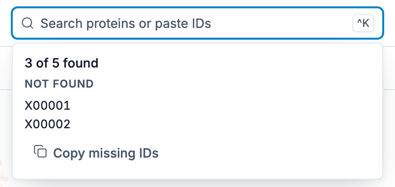
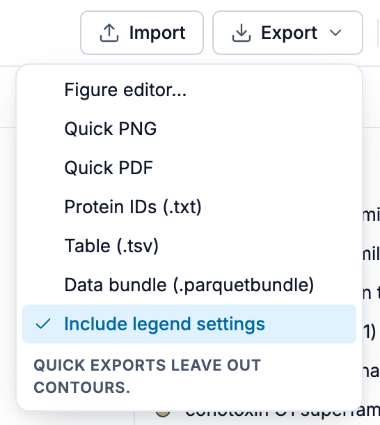
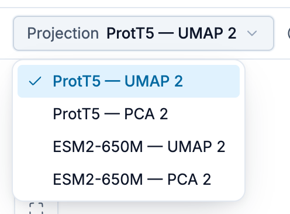
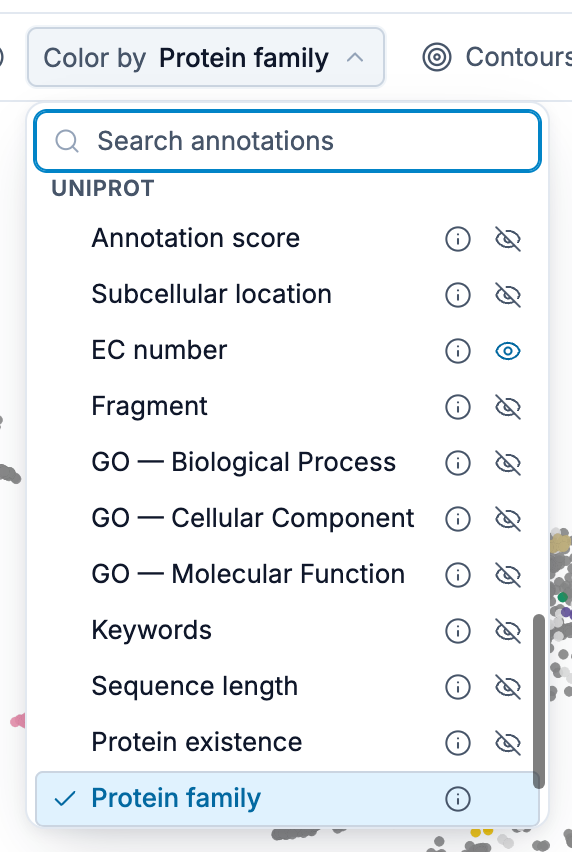
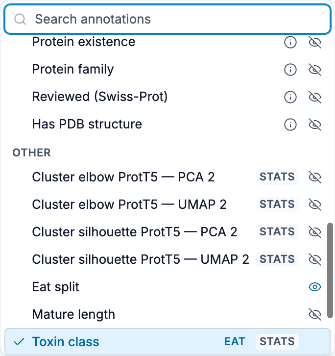
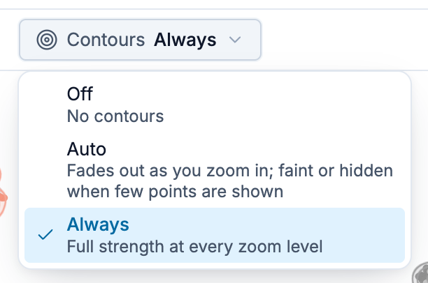
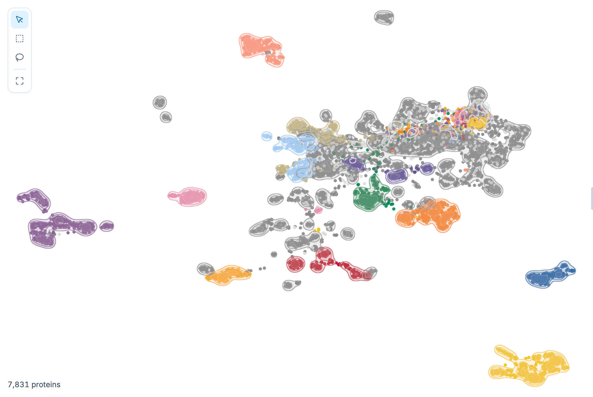

# Bars and Tools

The Explore page has two bars above the plot and a set of tools on the plot itself. The **app bar**
holds the dataset, search, Import and Export, the theme and help. The **view bar** below it
chooses what the plot shows. The **plot tools** select proteins and narrow the view.
[Interface Overview](/explore/) shows where each one sits; this page describes what each control
does.

## App bar

From left to right: the ProtSpace wordmark (back to the home page), the dataset menu, the search
box, **Import** and **Export**, **Theme**, **Help**, **Feedback** and **GitHub**. On a phone the
search box opens from a search button, and Theme and Help move into the view bar's **More** sheet.

### Dataset menu

The dataset's name and protein count, for example **Venom toxins (demo) · 7,831 proteins**. A long
name is shortened; hover it for the full name. Click it to open the same panel as
[Import](#import), where you can switch to another dataset.

### Search

Find specific proteins by ID:

1. Click inside the search box or press **⌘ K** (Mac) / **Ctrl + K** to focus it
2. Type the start of a protein ID (matching is anchored to the start, not anywhere inside)
3. Click a suggestion, or press **Enter** to take the highlighted row: the first row is highlighted
   as soon as you type, and the arrow keys move the highlight. Hovering does not move it, so a
   reflexive **Enter** on an ID you already selected deselects it
4. An unselected protein joins your selection, the box clears, and the list closes. One that is
   already selected is listed with a `✓`, gains a `✕` on hover or highlight, and is **removed**
   instead, leaving your query and the open list in place so you can prune several in a row

Focusing an empty box lists up to 10 proteins from your current selection, mixed in dataset order
with the first unselected IDs. **Escape** in the search box closes the list and empties the box; it
never clears the selection.

Paste several IDs at once (separated by newlines or spaces) and every matching protein is selected.
Pasting a list only ever adds. When something does not go as asked, a short report opens under the
box:

| Report                                      | When                                                                    |
| ------------------------------------------- | ----------------------------------------------------------------------- |
| **N of M found**, with a **Not found** list | A pasted list held IDs the dataset does not contain; **Copy** takes all |
| **No protein … in this dataset**            | You pressed **Enter** on an ID the dataset does not contain             |
| **… is already selected**                   | The ID you asked for is in your selection already                       |
| **… is selected but hidden in this view**   | It is selected, but a filter, Show only or a hidden category hides it   |

### Import

Click **Import**, or the [dataset name](#dataset-menu), to open the panel:

- **Open a file…** opens a file picker for a `.parquetbundle` or a FASTA file (`.fasta`, `.fa`,
  `.fna`) from your computer. For FASTA, ProtSpace sends the sequences to the prep service, which
  computes embeddings and projections and then opens the resulting bundle automatically. See
  [Importing Data](/explore/importing-data) for the full flow, size limits, and privacy
  implications. You can also drop either file type anywhere on the page.
- **Last file** reopens the file you imported last, which ProtSpace keeps in your browser. It
  shows only while another dataset is on screen.
- **Examples** lists the startup demo and the datasets behind the ProtSpace paper's figures;
  [Example Datasets](/explore/example-datasets) describes each one. Each item's label gives the
  protein count and download size, and its **ⓘ** icon says what the example is and what its
  curated view shows, with a link to its section of that page; **About these examples** above the
  list links to the whole page. Large examples carry a **Large** badge, and their ⓘ also gives the
  download size and the memory and time they take to open. The example currently loaded is
  disabled and marked with a check; its ⓘ still opens.

Choosing an example loads it and puts `dataset=<id>` in the URL, so the link is shareable and the
browser's **Back** button returns to whatever was shown before. The file you imported stays stored
in your browser (see
[Data & Settings Persistence](/explore/importing-data#data-settings-persistence)): **Last file**
reopens it, and visiting the app again without a `dataset` parameter brings it back. A link such as
`/explore?dataset=<id>`, with the id from the example's section of
[Example Datasets](/explore/example-datasets), loads the example the same way. An unknown id shows
a warning and the app starts up normally.

An example opens on its curated view: the projection, colour-by annotation and tooltip fields
chosen for it. A menu choice always opens that view with contours off, so the previous dataset's
`annotation`, `projection`, `tooltip` and `density` parameters don't carry over (**Back** still
returns to them); in a link, those parameters win over the curated ones. Changes you make to an
example aren't kept: it reopens in its curated state every time.

While an example downloads, the loading screen shows how much of it has arrived and offers
**Cancel download** until decoding starts. Cancelling leaves the current plot and the URL as they
were, with no message; on an empty page (a link opened fresh) it removes the `dataset` parameter
and runs the startup load instead. If an example fails to download, whether you chose it from the
menu or went **Back** or **Forward** to it, ProtSpace shows an error with a **Retry** button and
leaves the current plot and the URL as they were. Only a link opened on an empty page falls back to
the startup load.

### Export

Click **Export** to save your visualization or its data:

| Item                             | Saves                                                         |
| -------------------------------- | ------------------------------------------------------------- |
| **Figure editor…**               | A publication figure, laid out in the editor                  |
| **Quick PNG**                    | A raster image of the current view with legend                |
| **Quick PDF**                    | A PDF of the current view with legend                         |
| **Protein IDs (.txt)**           | The visible proteins' identifiers, one per line               |
| **Table (.tsv)**                 | The visible proteins with their coordinates and annotations   |
| **Data bundle (.parquetbundle)** | All data and, with **Include legend settings**, your settings |

See [Exporting Results](/explore/exporting) for image options (dimensions, legend size, font) and
the [Figure Editor](/explore/figure-editor) for publication figures.

### Theme

**Theme** switches the page between **System** (follow your operating system, the default),
**Light** and **Dark**. ProtSpace remembers your choice in this browser. The plot, the legend and
the structure viewer follow the theme; exported images and figures are always light.

### Help

**Help** opens **Documentation** (these pages), **Keyboard shortcuts** (every shortcut, grouped by
where it works) and **Take the tour** (the guided tour of the page). On a phone they are under
**More → Help & shortcuts**.

## View bar

The view bar sits under the app bar and holds what changes the picture: **Projection**,
**Color by** and **Contours**. On a tablet it also holds **Filter**; on a desktop, Filter is in
the sidebar's rail. When the window is too narrow for all of them, Contours and then Filter move
into **More**.

### Projection

Switch between the projections your bundle carries:

| Method       | Best For                           |
| ------------ | ---------------------------------- |
| **PCA**      | Initial overview, finding outliers |
| **UMAP**     | General exploration, balanced view |
| **t-SNE**    | Finding clusters                   |
| **PaCMAP**   | Fast alternative to t-SNE          |
| **LocalMAP** | Local structure, PaCMAP variant    |
| **MDS**      | Preserving distances               |

Different projections reveal different patterns, so try switching between them. The button beside
**Projection** opens the projection's details: how it was made and how faithful it is to the
embedding (see [Projection Metadata](/explore/scatterplot#projection-metadata)).

When you switch projections, the points glide from where they are to their new positions over about
0.8 seconds, so you can follow where each group goes. This also works while **Show only these** is
on. While the points move, duplicate-count badges, expanded stacks and EAT connectors are hidden,
and hovering shows no tooltip. If your system asks for reduced motion, the points jump to their new
positions at once.

::: info URL persistence
Your current projection is reflected in the page URL, so refresh, browser back/forward navigation,
and shared links reopen the same view when possible. A bare `/explore` URL stays unchanged on first
load; ProtSpace writes projection and annotation params after you change the view or when it needs
to normalize an invalid URL value.
:::

::: warning 3D Projections are deprecated
3D projections load and are shown as their X/Y view; the third (Z) dimension is not rendered in
the web viewer. Reading them is deprecated and ends in ProtSpace 5.0.0, and opening a file of your
own with 3D projections shows a notice saying so. For PCA the X/Y view is the same as the 2D
projection (`pca2`); for UMAP, t-SNE, PaCMAP and other non-linear methods it is the 3D layout seen
from one side, so points that are far apart along Z can overlap. If you have the embeddings,
recompute the projection with the 2D method (e.g. `umap2`). Otherwise `protspace convert
--flatten-3d` rewrites each 3D projection as a 2D one with its X/Y coordinates, named
`<name> (X/Y)`. See [`protspace convert`](/guide/python-cli#protspace-convert).
:::

### Color by

Choose which annotation colours the points:

- **Grouped categories**: annotations are organized into sections, one per source (Biocentral,
  InterPro, TED, Taxonomy, UniProt, Other)
- **Search**: type to filter annotations by name (case-insensitive)
- **Keyboard navigation**: use the arrow keys to move the highlight, **Enter** to select,
  **Escape** to close. Hovering does not move the arrow-key highlight, and **Enter** picks the row
  under the pointer whenever one is hovered.

Only categories present in your dataset appear in the menu. Any columns that don't match a known
category appear under **Other**. See the
[ProtSpace Python package](https://github.com/tsenoner/protspace) for the complete list of
available annotations per source.

::: info ⚡ Predicted badge
A ⚡ badge next to an annotation name marks a **computational prediction** rather than curated or
experimental data. Hover it for the tooltip "Predicted: computational, not experimentally
curated". The same badge appears next to the legend title when a predicted annotation is active.

Flagged annotations are:

- **Signal peptide (Phobius)**, de-novo topology predictor
- **TED domains**, domains parsed from predicted AlphaFold structures
- All **Biocentral** columns: Subcellular location, Membrane, Signal peptide, Transmembrane
- Any other column whose name starts with `predicted_`

Reference signature-database matches (Pfam, CATH-Gene3D, SUPERFAMILY, SMART, CDD, PANTHER) and
curated data (UniProt, Taxonomy) are deliberately **not** flagged. See
[Annotations](/guide/annotations) for the full column reference.
:::

::: info STATS badge
A **STATS** badge marks an annotation that the bundle scored **for the projection you are currently
viewing**. It carries no number; it only says the scores exist. Hover it for the tooltip "Quality
statistics available: select this annotation and open the projection metadata panel".

The badge disappears when you switch to a projection the annotation was not scored on. Select the
annotation and open the [projection details](/explore/scatterplot#projection-metadata) to read the
numbers, or see [Separation Scores](/explore/separation-scores) for what they mean.
:::

::: info EAT badge
An **EAT** badge marks an annotation in which some proteins carry a value **transferred from a
nearby annotated protein** instead of a curated record of their own, not to be confused with the ⚡
badge. Hover it for the tooltip "Embedding Annotation Transfer predictions available". Select the
annotation to see which proteins those are, and open the EAT panel from the rail for its
controls. See [Transferred Annotations (EAT)](/explore/eat) for the whole feature.
:::

::: info Tooltip-only annotations
`gene_name`, `protein_name`, and `uniprot_kb_id` are left out of Color by but are still shown in the
[tooltip](/explore/scatterplot#protein-tooltip) on hover.
:::

### Contours

**Contours** draws density rings over the points, so you can see where each category concentrates
even where its points pile on top of each other. The button names the current mode, such as
**Contours Off** or **Contours Auto**. When the window is narrow it shows only the mode, and on a
narrower one the modes move into **More**.

| Mode              | What it does                                                        |
| ----------------- | ------------------------------------------------------------------- |
| **Off** (default) | No contours                                                         |
| **Auto**          | Fades out as you zoom in; faint or hidden when few points are shown |
| **Always**        | Full strength at every zoom level                                   |

Auto and Always draw the same rings and fill; only their strength differs. Auto sets it from how
many points are visible, how large the plot is and how far you have zoomed in. It does not check
whether points actually overlap.

How to read them:

- Every legend colour gets its own set of rings in that colour. Each ring inward marks a doubling
  of density, and a light fill deepens toward the densest core.
- A spot needs more than 5 points of one colour close together (about 7 piled on one spot) before it
  gets a ring, so scattered points get none.
- Hidden categories are left out, and selected points are drawn on top of the contours.
- Categories that share a colour share rings. Past 16 colours, the 15 largest keep their own rings
  and the rest share one grey set. N/A rings are light grey, so they are faint on a light
  background.
- The rings are computed on a fixed grid across the plot, so they sit in the same place on every
  screen and at every browser zoom, and lines are equally thick everywhere.

The menu works from the keyboard: with the button focused, **Enter** or **Space** opens it, the
arrow keys, **Home** and **End** move the highlight, **Enter** picks, and **Escape** closes it.

::: tip Auto on small datasets
Auto counts the visible points. In the full view of a plot about 1000 px wide it shows nothing below
about 360 visible points and reaches full strength from about 2,700, and a wider plot needs more.
Points you hide, filter out or leave out with **Show only these** do not count. For a small dataset,
such as a FASTA upload, or a small subset, pick **Always**.
:::

::: info URL persistence
The mode is kept in the page URL as `density=auto` for Auto or `density=on` for Always; Off leaves
the parameter out. A shared link opens with the same mode.
:::

::: warning Not in exported images yet
Contours are not drawn in exported images (Quick PNG and PDF, the
[Figure Editor](/explore/figure-editor) and its zoom insets): the file shows the points only. The
Figure Editor preview shows exactly what will be exported. Tracked in
[#498](https://github.com/tsenoner/protspace/issues/498).
:::

::: info Devices without contour support
Contours need floating-point render targets with float blending (`EXT_color_buffer_float` and
`EXT_float_blend`), and many iPhone and iPad browsers lack `EXT_float_blend`. On such a device, or
when the graphics driver refuses the contour shaders or buffers, choosing Auto or Always (or opening
a link with `density=`) shows a one-time **Contours unavailable** notice: "Contours are unavailable
on this device, so the Contours setting has no effect. Points are drawn as usual.", followed by the
cause in brackets, such as `(EXT_float_blend missing)`. The link keeps its `density=` parameter, so
it still shows contours on a device that supports them.
:::

### Filter

**Filter** opens the Filter panel in the sidebar, in place of the legend, where you build a query
from annotation values. On a desktop it is the rail's Filter button, which carries a dot while a
filter is applied. On a tablet it is in the view bar, and shows how many conditions are applied.
On a phone, Filter is in **More**. [Filtering](/explore/filter) describes the panel.

### More

**More** appears when the window is too narrow for the whole view bar and holds what no longer fits:
the contour modes, then (on a tablet) Filter. A dot on it says that something inside is on (contours, or an
applied filter). On a phone, **More** opens a sheet that also holds Import, Export, Theme,
Help & shortcuts and Feedback.

## Plot tools

### Selection tools

The tool strip in the plot's corner picks what a drag on the plot does:

| Tool              | A drag on the plot                         |
| ----------------- | ------------------------------------------ |
| **Move and zoom** | Pans; the scroll wheel zooms (the default) |
| **Box select**    | Draws a rectangle and selects inside it    |
| **Lasso select**  | Draws a free outline and selects inside it |

**Fit to view** zooms back to show every protein, as a double-click on the plot does. See
[Box Selection](/explore/scatterplot#box-selection) and
[Lasso Selection](/explore/scatterplot#lasso-selection) for details.

### Selection bar

While proteins are selected, a bar beside the protein count, at the bottom of the plot, shows how
many and offers:

- **Show only these** hides every other protein. The plot's status corner then shows a
  **Showing only** chip; its ✕ (**Show all proteins**) brings them back.
- **Zoom to them** fits the view to the selection.
- **Copy IDs** copies the selected IDs, one per line.
- **Clear** empties the selection.

**Escape** also clears the selection; pressed again, it returns to **Move and zoom**. Escape in the
search box only closes the suggestion list and empties the box; it never clears the selection,
however many times you press it.

### Status chips

The plot's bottom-left corner counts the proteins on screen (**N proteins**) and shows a chip for
each way the view is narrowed:

| Chip                                  | Its ✕                      |
| ------------------------------------- | -------------------------- |
| **Filtered · N conditions**           | **Remove filter**          |
| **Showing only N proteins · K steps** | **Show all proteins**      |
| **N categories hidden**               | **Show hidden categories** |

Clicking the Filtered chip opens the [Filter panel](/explore/filter).

### Undo and redo

**⌘ Z** (Mac) / **Ctrl + Z** undoes the last selection, **Show only these** or filter step, and
**⇧ ⌘ Z** / **Shift + Ctrl + Z** redoes it. Removing a filter also shows a notification with an
**Undo** button. **Help → Keyboard shortcuts** lists every shortcut.

## Tips

- **Compare projections**: patterns that appear in several projections are more reliable
- **Use search**: find known proteins quickly to orient yourself
- **Export often**: save interesting views for later

## Next Steps

- [Filtering](/explore/filter) - Build annotation filters
- [Viewing 3D Structures](/explore/structures) - AlphaFold integration
- [Exporting Results](/explore/exporting) - Detailed export options
