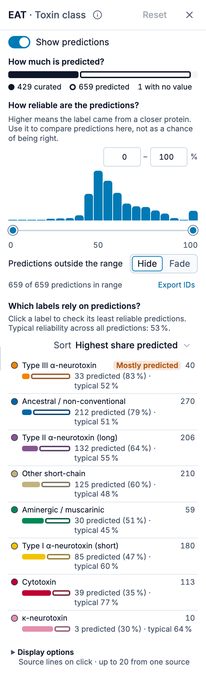
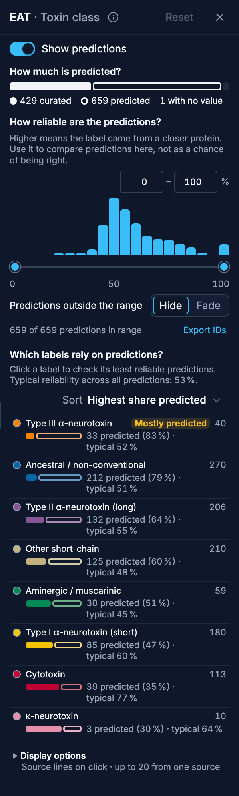
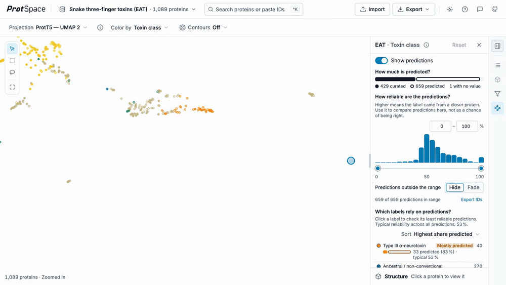
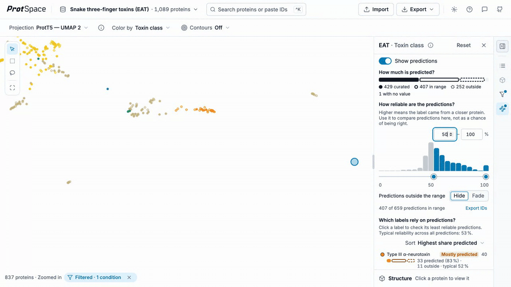
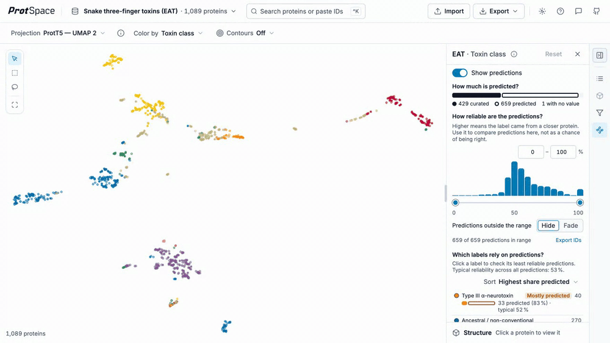
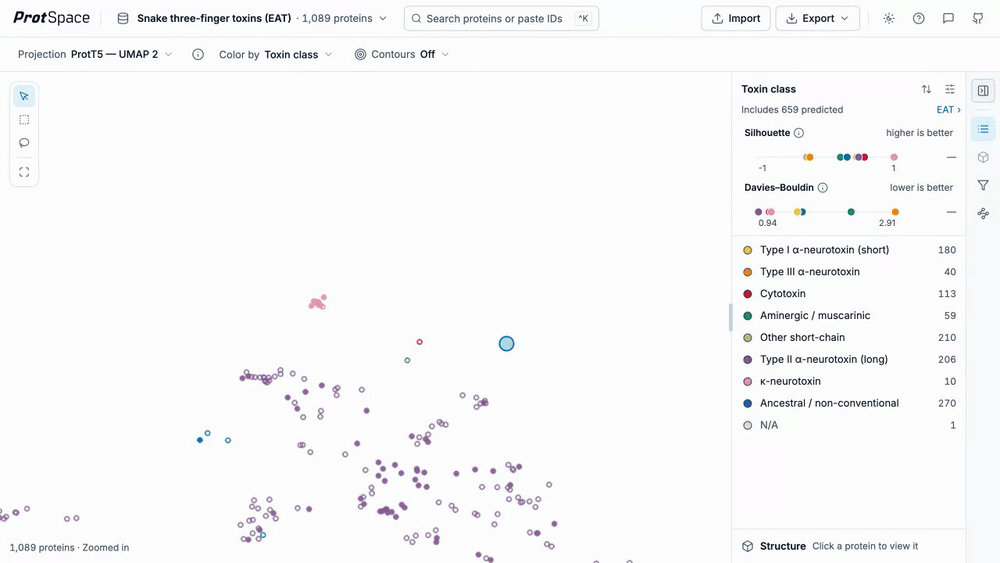
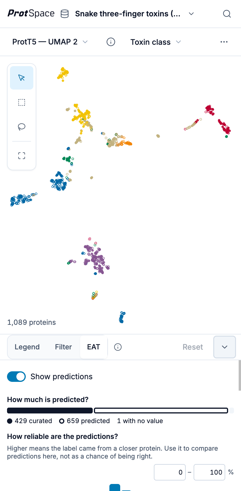

# Transferred Annotations (EAT)

Most annotation columns have holes in them. A protein that nobody has characterised has no EC number, no family, no GO term, and colouring by that column leaves it in the `N/A` bucket where it says nothing at all.

Embedding Annotation Transfer (EAT) fills those holes by borrowing. For every protein missing a value, it finds the nearest annotated protein in the original high-dimensional embedding space (not in the 2D layout you are looking at) and copies that protein's label across, along with a reliability index in [0, 1] and the identifier of the protein it came from.

The borrowed values never overwrite anything. They live in their own columns, so a transferred value and a curated value are two different facts about a protein, and the interface keeps them visibly apart. A bundle that carries predictions shows them by default, with nothing hidden by reliability, so your first view already includes every borrowed value.

All the EAT controls live in one place: the **EAT panel** in the sidebar.

::: info Predictions are made before you open the dataset
Transfer runs in the Python CLI, not in the browser: `protspace transfer` writes the prediction columns into a bundle. Nothing on this page creates predictions, it only shows the ones a bundle already carries. See [`protspace transfer`](/guide/python-cli#protspace-transfer) for the command and its options.
:::

## The Three Columns

For a curated column `COL`, transfer adds three companions and leaves `COL` itself untouched:

| Column                 | Holds                                                                  |
| ---------------------- | ---------------------------------------------------------------------- |
| `COL__pred_value`      | The borrowed label.                                                    |
| `COL__pred_confidence` | The reliability index, 0 to 1. The EAT panel shows it as a percentage. |
| `COL__pred_source`     | The identifier of the reference protein the label came from.           |

A protein that already had a curated value gets no prediction at all, so the three columns are populated only where `COL` was empty.

A transfer run with `--max-distance` adds a fourth column, `COL__neighbor`, shown in the Annotation dropdown as the annotation's name followed by **— EAT neighbourhood**. It holds `near` for a query whose nearest reference lay within the distance cutoff and `distant` for one whose did not, and nothing for proteins that were not queries. Unlike the reliability, it is an ordinary annotation: colour by it, filter by it, or hide one of its legend values. See [Near or distant](/guide/python-cli#near-or-distant) for how the cutoff is chosen.

## Finding Them

Annotations carrying predictions are marked with an **EAT** badge in the [Color by menu](/explore/controls#color-by), beside the annotation's name. The badge appears only for columns that have at least one transferred value, so it doubles as the list of what is worth exploring. If no annotation carries the badge, the bundle has no predictions in it.


This is not the ⚡ **Predicted** badge, which marks a whole column as computational based on its name. An **EAT** badge means the opposite: the column is curated, and only some of its cells were filled in. See [Predicted Annotations](/explore/legend#predicted-annotations).

## Opening The EAT Panel

The panel always describes the annotation you colour by. Its header reads **EAT · Toxin class**, with an ⓘ that sums up what EAT is, **Reset**, and ✕ to close it. There are four ways in:

- **The rail.** On a desktop, the EAT button sits in the icon rail at the sidebar's right edge, under Legend and Filter. The panel takes the legend's place above the structure.
- **The tabs.** On phones and tablets the sidebar's panel has three tabs: **Legend**, **Filter** and **EAT**.
- **The legend.** When Color by has predictions, the legend shows one line under its title, such as `Includes 659 predicted`, with an **EAT ›** link that opens the panel. Once you narrow the range it adds what happens to the rest, `· outside 50–100 % hidden` (or `faded`), and with predictions off it reads `659 predictions off, shown as N/A`.
- **The Filter panel.** A reliability range shows there as a locked row with **Edit in EAT ›**. See [The Filter Panel's Locked Row](#the-filter-panel-s-locked-row).

The EAT button and tab are greyed out when there is nothing to show. Hover the button, or tap the tab, to read why: `This dataset has no transferred annotations (EAT).`, or, when the dataset has predictions but not for the current annotation, `Toxin family has no EAT predictions. Color by an annotation marked EAT.` If the panel is already open when you switch Color by to such an annotation, it says `<annotation> has no predicted values.` and lists the annotations that do have predictions, each with its share predicted, to colour by in one click.

A dot on the rail button (or the tab) means some EAT setting differs from its default. **Reset** puts every setting back: predictions shown, the range at 0–100 %, **Hide**, and source lines on click with up to 20 from one source.




From the top, the panel holds the **Show predictions** switch, three sections that each answer one question, and **Display options** at the bottom. When you select a single protein, a **Selected protein** strip appears under them.

## Show Predictions

**Show predictions** turns the borrowed values on and off. It is on by default. With it on, every transferred protein is coloured by its borrowed value and joins that value's legend row, so the row counts and the plot both reflect the filled-in column.

Turn it off and those proteins fall back to their curated cell, which is empty, so they return to `N/A`. The panel says `Predictions are off. The map shows them as N/A.`, its charts turn grey, and the range controls are disabled. The curated data is never modified, so switching back is instant and loses nothing.

## How Much Is Predicted?

The first section is one bar split into parts, in the same language as the plot:

- **Solid** is curated: proteins with a value of their own, drawn as filled dots on the map.
- **Hollow** (an outline) is predicted: proteins with a borrowed value, drawn as rings on the map.
- **Dashed** is predicted but outside the reliability range you chose. It appears only once you narrow the range.
- **The empty track** at the end is **no value**: proteins with neither a curated value nor a prediction.

The key under the bar carries the counts, for example `● 429 curated ○ 659 predicted 1 with no value`. With the range narrowed, the predicted entry splits into `○ 407 in range` and `◌ 252 outside`. Hover a part of the bar for its count and share.

The panel counts the proteins that pass your other filter conditions. When a filter narrows the view, the section adds an `In view:` line, how many of the dataset's proteins that leaves.

## How Reliable Are The Predictions?

The second section is a chart of the predictions by reliability: 20 bars, each 5 % wide, from 0 at the left to 100 % at the right. Under it is the **range**: two handles on the axis, and two boxes above the chart that show the same two numbers. Drag a handle or type a number to choose which predictions you keep.

- The range includes both ends: `50–100 %` keeps a prediction of exactly 50 %.
- **0–100 %**, the default, keeps everything. It is no filter at all.
- The bars inside the range stay coloured; those outside turn pale.
- The line under the chart counts what you keep: `407 of 659 predictions in range`.

Curated proteins are never affected. The range applies only to predictions.



### Hide or Fade

**Predictions outside the range** decides what happens to the predictions you did not keep:

| Choice   | On the map                                     | Filter                                                      |
| -------- | ---------------------------------------------- | ----------------------------------------------------------- |
| **Hide** | They leave the map, like any filtered protein. | Writes one condition into the [filter](/explore/filter).    |
| **Fade** | They stay, drawn faint, and stay clickable.    | None. The plot shows an `EAT: outside 50–100 % faded` chip. |

**Hide** is the default. Choose **Fade** to see where the weak predictions sit without losing them from the picture. Click the Fade chip to open the EAT panel. Its ✕ (**Stop fading EAT predictions**) resets the EAT panel, as **Reset** does.



Because Hide is a real filter, it interacts with everything else that responds to a filtered view. The plot's **Filtered** chip appears, and the [separation score](/explore/separation-scores) strips hide while it is on, since whole-dataset scores would contradict a narrowed view. Fade filters nothing, so the strips stay.

### What The Reliability Means

The panel's helper line says it in one sentence: higher means the label came from a closer protein. Use it to compare predictions here, not as a chance of being right.

The reliability index is a transform of the distance to the reference protein: closer neighbour, higher number. Its exact form depends on the `--metric` and `--k` used at transfer time, and the [reliability index](/guide/python-cli#reliability-index) section gives the formulas. The distance itself is not stored in the bundle; `protspace transfer --report` writes it, with each query's nearest references, to a [neighbour report](/guide/python-cli#neighbour-report).

::: warning Rank, not probability
With the default `cosine` metric the reliability index is a bounded cosine similarity; with `--metric euclidean` it is the goPredSim transform, which was calibrated on ProtT5. On other embedding spaces, whose raw distances can be on a very different scale, treat it as a way of ranking predictions against each other rather than as a probability that the label is correct. A 90 % is more trustworthy than a 60 % in the same dataset, but it is not a 90 % chance of being right. Values produced with different `--k` settings are not comparable at all.
:::

## Which Labels Rely On Predictions?

The third section has one row per label of the annotation. Each row has two lines:

- **Line 1:** the label's colour, its full name and its protein count. A **Mostly predicted** tag marks a label whose members are more than 80 % predicted.
- **Line 2:** a small bar of that label's make-up, solid for curated and hollow for predicted (dashed for outside the range), then the facts: `212 predicted (79 %) · typical 51 %`. With the range narrowed, it also says how many are outside, as in `33 predicted (83 %) · 11 outside · typical 52 %`.

**Typical** is the typical (median) reliability of that label's predictions. The helper line above the rows gives the same figure for all predictions together, `Typical reliability across all predictions: 53 %.`, so you can see which labels sit below it. A label with only curated members in view says `No predictions in view`.

**Sort** orders the rows:

| Order                       | First                                              |
| --------------------------- | -------------------------------------------------- |
| **Highest share predicted** | the labels that rely most on predictions (default) |
| **Most predictions**        | the labels with the most predicted proteins        |
| **Least reliable**          | the labels with the lowest typical reliability     |
| **A–Z**                     | by name                                            |

The panel shows 8 rows at first. With more labels, **Show all N labels** lists the rest.

## Checking Doubtful Predictions

The panel is built for one loop: find the weakest predictions, look at each one, and see where its label came from.

1. **Click a label row**, or a bar of the reliability chart. A list opens under it: **5 least reliable predictions** (for a bar, `5 least reliable in 20–25 %`), weakest first. Each row shows the protein's ID, its reliability and `from <source ID>`. A row outside the range says `Hidden, outside the range` or `Faded, outside the range`, and you can still pick it.
2. **Pick one.** The protein is selected and the map zooms to it. The list stays open, so you can work down it. The [structure](/explore/structures) opens collapsed to its header row, so it does not push the list away; click its header to expand it.
3. **Read the Selected protein strip** at the bottom of the panel.
4. **Go to source** selects the protein the label was copied from, fits both on the map, and draws the dashed line between them, with a ring on the source.



Under each list, **Select all 212 in range** selects every prediction in range behind that label or bar, **Export IDs** downloads their IDs, and `Showing 5 of 212` says how many there are. Click the row or bar again, or press Escape, to close the list.

### The Selected Protein Strip

The strip appears whenever exactly one protein is selected, whether you picked it from a list or clicked it on the map. For a predicted protein it shows:

- a ring in the label's colour, the ID, the borrowed label, and `reliability 26 %`;
- `copied from Q06ZW0 (curated)`, or `(predicted)` when the source itself was predicted, followed by `source of 9 predictions` when the source lent its label to others. Click that link to draw a line from the source to each of them, without changing the selection;
- its rank: `Less reliable than 98 % of the 659 predictions`, or `More reliable than …` for one in the top half;
- **Go to source**.

For a curated protein that lent its label, the strip shows a filled dot, the ID, `Curated` and `source of N predictions`.

If the picked prediction is outside the range, the strip says so: `Hidden on the map: outside the 50–100 % range · Show faded`. **Show faded** switches to Fade, so you can see it on the map. In Fade, the line reads `Faded on the map: outside the 50–100 % range`.

## Display Options

**Display options**, closed at the bottom of the panel, holds the settings for how lines are drawn. Its summary says what is set, for example `Source lines on click · up to 20 from one source`.

- **Draw a line to the source when I click a protein** (on by default): a click on the map traces the transfer, as described in [Where A Prediction Came From](#where-a-prediction-came-from). Turn it off and a click only selects. **Go to source** and **source of N predictions** still draw.
- **Most lines from one source**: 10, 20 (the default) or 50. A source with more dependants draws only this many lines.
- **Other annotations with predictions (N)**: the other annotations that carry predictions, each with its share predicted. Click one to colour by it. When the transfer ran with `--max-distance`, a **Color by … — EAT neighbourhood** link sits here as well.

## Telling Them Apart In The Plot

A transferred protein is drawn as a **hollow ringed marker**: its shape and its colour are exactly those of the value it borrowed, but the interior is punched out, leaving a ring. Curated proteins stay solid.

This means the two populations read as one distribution at a glance, since the colours match, while any individual point still declares which kind it is. The ring thickness scales with the marker, so from **Shape size** 10 up the hole stays open and the ring never thins to a hairline on large markers. Only at the smallest sizes, where a dot is a few pixels across, can the hole shrink below a pixel. Large datasets [default to such sizes](/explore/legend#default-dot-size), so raise the shape size there if the rings are hard to tell apart.

Hover a transferred protein and its tooltip carries a **Predicted (transferred)** block for the active annotation: the reliability as a percentage, a bar showing the same number, and the line `Reliability index · source <ID>` naming the reference protein the label was copied from.

Three things are worth knowing about when the rings appear:

- Only for the annotation you are currently colouring by. A protein can carry transfers for several columns; only the active one is drawn.
- Only while **Show predictions** is on.
- In exported images too. The live renderer and the [export](/explore/exporting) renderer share one shader, so a PNG or the [Figure Editor](/explore/figure-editor) output keeps the same solid/hollow distinction.

::: warning A ringed marker is a guess
Hollow means "no curated value existed and this is the nearest neighbour's label". It is an inference from embedding geometry, not evidence. Read a hollow cluster as a hypothesis about that region of the map.
:::

## Where A Prediction Came From

Provenance is also drawable. With predictions shown and **Draw a line to the source when I click a protein** on, clicking a point in the plot traces the transfer as dashed lines, in whichever direction makes sense for the point you clicked:

- **Click a transferred protein** and one dashed line joins it to its source, the protein whose label it borrowed for the currently active annotation.
- **Click a source protein** and dashed lines fan out to every protein that borrowed from it.



A protein that is both a transferred protein and a source for others takes the first case: only its own source line is drawn. If that source's legend category is hidden, the click draws nothing at all.

Endpoints get an unfilled halo so you can find the termini without the emphasis covering the markers underneath. Clicking still selects the protein exactly as it always did: the lines are drawn on top of normal selection, not instead of it.

A heavily reused source can have hundreds of dependants, so the fan-out is capped by **Most lines from one source** (20 unless you change it), taking the most reliable targets first with the protein identifier as a deterministic tie-break. Candidates whose legend category is hidden are excluded outright. Candidates that exist but are currently off-view, removed by a filter or by [Show only these](/explore/controls#selection-bar), are reported instead of drawn: a small status strip appears at the top of the plot reading `3 hidden (off view)` with a × to dismiss it. It shows only when something is actually missing, so a fully drawable click is silent.

The lines are transient and clear on Escape, on the status strip's close button, on clicking empty plot space, on clearing the selection, on changing the annotation, on toggling a legend category's visibility, on turning **Show predictions** off, and on loading new data.

They do survive everything that only changes the view. The lines hold protein identifiers rather than coordinates, so switching projection (`ProtT5 — PCA 2` to `ProtT5 — UMAP 2`, say), flipping a 3D plane, panning, zooming, filtering, or **Show only these** re-resolves both endpoints against the new layout rather than dropping the lines. An endpoint that a filter removed comes back as a line when the filter is cleared, without a second click.

## Export IDs

**Export IDs**, beside the `407 of 659 predictions in range` line, downloads protein IDs as a text file, one ID per line, in reliability order. It offers two lists:

- **In range (407)**: the predictions you keep, saved as `<annotation>-eat-in-range-ids.txt`, for example `toxin_class-eat-in-range-ids.txt`.
- **Outside the range (252)**: the ones you left out, saved as `<annotation>-eat-outside-range-ids.txt`.

The same button under a label's or a bar's list exports only that label's or bar's predictions. Each export counts only the proteins that pass your other filter conditions. A list that is empty is greyed out.

## The Filter Panel's Locked Row

In **Hide**, a narrowed range is an ordinary filter condition, so the [Filter panel](/explore/filter#reliability-and-the-filter) lists it. It shows as one locked row, because the EAT panel owns it:


**Edit in EAT ›** opens the EAT panel (and colours by that annotation if you had switched away). The ✕ puts the range back to 0–100 %. Removing the whole filter, from the Filter panel or the plot's **Filtered** chip, does the same. The condition keeps curated proteins visible: they have no reliability, and the condition matches them on purpose.

Each annotation keeps its own condition. If you switch Color by while another annotation's range still filters the map, the EAT panel says so under the switch, for example `Toxin class is still filtered to reliability 50–100 %`, with **Clear**.

The reliability columns are not in the Filter panel's annotation list or in Color by: the EAT panel is where you set them.

## Phones And Tablets

Below 951 px the panel is the **EAT** tab of the panel under the plot, beside **Legend** and **Filter**. It holds the same sections in a more compact form: a shorter chart, larger touch targets, and the Selected protein strip as one row, such as `○ V8N5J6 · reliability 26 % · from Q06ZW0`, with **Go to source**.



## What A Bundle Saves

**Export → Bundle** with settings included stores:

- whether **Show predictions** is on;
- the **low end of the range**, when you use **Hide**.

It does not store the high end, **Fade**, the label sort, or the Display options. A bundle saved at `50–80 %` reopens at `50–100 %`, and one saved in Fade reopens with the full range. The Display options last until you reload the page; they carry over when you open another dataset.

## Which Unknowns Sit Near My References?

A common question for a set of unknown proteins and a curated reference set: which unknowns resemble a reference closely enough to be worth a look, and which resemble nothing? Transfer answers it in the embedding itself, which is more faithful than proximity in a 2D projection: the layout distorts distances, and two projections that agree can share the same distortion.

1. **Give the references a column the unknowns lack**, a family, class or reference ID. Transfer's queries are the proteins missing a value in that column, so a column the unknowns also fill (a dataset or group column) gives it nothing to do.
2. **Run the transfer with a cutoff and a report**:

   ```bash
   protspace transfer -b space.parquetbundle -e emb.h5 -t toxin_family \
     --max-distance auto --report predictions.tsv -o space_eat.parquetbundle
   ```

   Transfer reads only the vectors, so `-e` needs no `:name` suffix. `predictions.tsv` lists every unknown with its nearest reference, the raw distance and whether it is near or distant; sort it by `distance` for a candidate list. With `--k 5` it lists the five nearest references of each. See the [neighbour report](/guide/python-cli#neighbour-report).

3. **Open the bundle here** and colour by **Toxin family — EAT neighbourhood** to see the near and distant unknowns, or colour by **Toxin family** and raise the low end of the EAT panel's range to keep only the confident transfers. Curated references stay visible either way: they are `N/A` in the neighbourhood column and carry no reliability.
4. **Export the proteins you kept.** In the EAT panel, **Export IDs → In range** gives the predictions you kept. Or, coloured by the neighbourhood column, hide its `distant` legend value (or `near`) and `N/A` (the references), then **Export → Protein IDs**, or **Export → Table** for the same proteins with their coordinates and annotations, the `__pred_*` columns included: either export holds exactly the proteins still visible. See [Exporting](/explore/exporting#what-gets-exported). For everything at once, `protspace export space_eat.parquetbundle space.tsv` writes every protein with every annotation, the `__pred_*` and `__neighbor` columns included, as one table (see [`protspace export`](/guide/python-cli#protspace-export)).

## Trying It

The **Snake three-finger toxins (EAT)** example holds 1,089 three-finger toxins from snakes. UniProt curators have classified 536 of the 537 reviewed ones; the one left, the muscarinic toxin Mlalpha (P0DJB0), has no curated subfamily and shows as N/A. The 552 unreviewed ones, mostly sequenced from venom glands, have no class, and EAT transferred one to each from the nearest reviewed toxin in the ProtT5 embedding. To make the transfers checkable, a fifth of the reviewed toxins, 107, were held out: their class was withheld and transferred like the others, and `toxin_class_withheld` keeps the truth.

Open the **Import** menu's **Examples** section and choose it, or visit `/explore?dataset=three-finger-toxins` directly. [Its section of Example Datasets](/explore/example-datasets#three-finger-toxins) says how it was built.

It opens coloured by `toxin_class` with every transfer shown: the 659 rings, one for each unreviewed and held-out toxin, sit in the islands of the classes they borrowed. Open the EAT panel: the key reads `429 curated`, `659 predicted` and `1 with no value`, and **Type III α-neurotoxin** tops the labels, mostly predicted. Hover a held-out toxin (colour by `eat_split` to find them) and its tooltip shows the borrowed class next to `toxin_class_withheld`; they agree for 101 of the 107 held-out toxins (94 %). Set the range to 50–100 % to keep the 407 transfers EAT was most confident in, 312 onto unreviewed toxins and 95 onto held-out ones, all 95 of them right. The rings between the islands go first. Then click **Ancestral / non-conventional** to check its five weakest predictions one by one.

## Next Steps

- [Using the Legend](/explore/legend) - per-category visibility, and the legend's one-line EAT note
- [Bars and Tools](/explore/controls) - Color by and the other controls
- [Filtering](/explore/filter) - the filter panel the reliability range writes into
- [Using Python CLI](/guide/python-cli#protspace-transfer) - `protspace transfer`, its flags, and the reliability formulas
