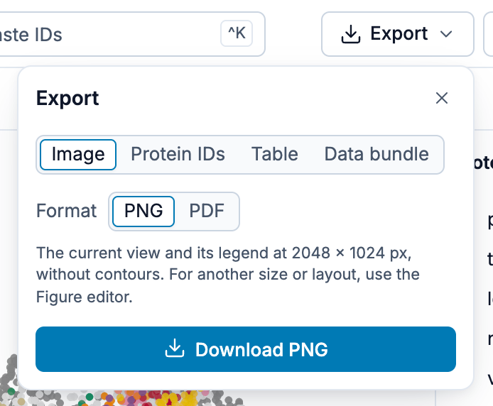
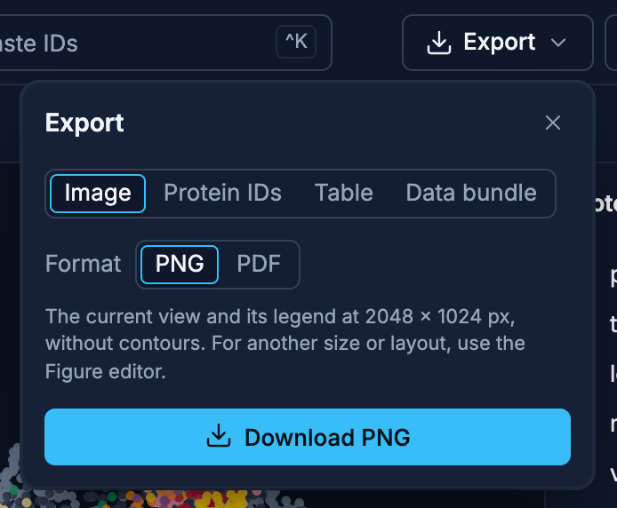
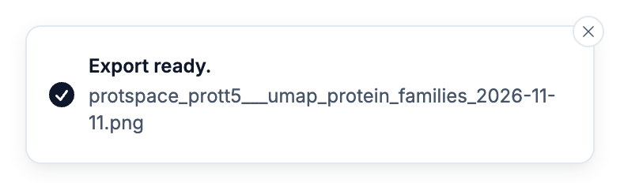
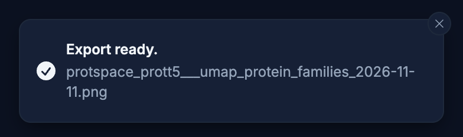

# Exporting Results

ProtSpace allows you to export publication-ready figures, raw data, protein IDs and tables.

## Export Panel

Click **Export** in the app bar, just before **Figure editor** (on a phone: **More**, then
**Export**). The Export panel asks what to export first, then shows only that choice's options:

{.light-only}
{.dark-only}

| Choose          | Then                               | Download saves                                              |
| --------------- | ---------------------------------- | ----------------------------------------------------------- |
| **Image**       | **PNG** or **PDF**                 | The current view with its legend, 2048 × 1024 px            |
| **Protein IDs** |                                    | The visible proteins' identifiers, one per line (`.txt`)    |
| **Table**       |                                    | The visible proteins as a [table](#table-export) (`.tsv`)   |
| **Data bundle** | Whether to include legend settings | A `.parquetbundle` with all data and, if you like, settings |

The button at the bottom names the file, for example **Download PNG** or **Download .tsv**; it
saves the file and closes the panel, which keeps your choice for next time. Every export confirms
with a message naming the downloaded file:

{.light-only}
{.dark-only}

## Image Export (PNG / PDF)

Images have two paths:

### Figure Editor (Recommended)

Click **Figure editor** at the right of the app bar to open a full-screen editor with live preview
(in a window narrower than 1200 px the button shows its image icon only; on a phone: **More**,
then **Figure editor**).
This is the primary workflow for creating publication-quality figures. See the
[Figure Editor guide](./figure-editor) for full documentation.

Key features:

- **Journal presets** for Nature, Science, Cell, PNAS, PLOS, and presentations
- **Photoshop-style Dimensions panel**, Width/Height/DPI, unit toggle (px/mm/in/cm), Resample on/off, aspect-lock chain
- **Overlays**, circles, arrows, and text labels to annotate your figure
- **Zoom insets**, true geometric magnification with a per-inset Dot size slider
- **Legend customization**, position, font size in pt or px, columns, free-floating placement
- **Click-to-select + Delete/Backspace**, click an overlay or inset (canvas or sidebar) and press Delete to remove it
- **Persistent settings**, your layout is saved to localStorage and optionally embedded in `.parquetbundle` files
- **Print-correct output**, PNG includes pHYs DPI metadata; PDF page size is mm-accurate

### From the Export panel

Choose **Image**, then **PNG** or **PDF**, in the [Export panel](#export-panel) to download an
image at once, with no preview. It always uses fixed defaults, a 2048 × 1024 px image with the
legend on the right, and keeps your current zoom and pan; it does not use Figure Editor settings.
For another size or layout, or for the full plot, use the Figure Editor.

### Dot size in images

Dots [grow as you zoom in](/explore/scatterplot#navigation). An image from the Export panel keeps
your current zoom, so its dots match the size you see on screen. The Figure Editor always renders the full view, so its
dots are drawn at their unzoomed size.

### Plot shape in images

As on screen, the plot fills the image: each axis stretches to the image's width or height. A wide
image stretches the clusters sideways, a tall one stretches them up and down.

::: warning Contours are not exported yet
[Contours](/explore/controls#contours) are not drawn in exported images: a PNG or PDF from the
Export panel, the Figure Editor and its zoom insets show the points only. The Figure Editor preview shows
exactly what will be exported. Tracked in [#498](https://github.com/tsenoner/protspace/issues/498).
:::

::: info Exports are always light
A PNG or PDF from the Export panel, the Figure Editor's preview and its exports always use the light colours (a
white background and the light greys for `Other` and `N/A`), whatever theme the app shows, so a
figure looks the same whoever made it. See [Light and dark](/explore/#light-and-dark).
:::

## Parquet Export

Choose **Data bundle** in the [Export panel](#export-panel) to save a `.parquetbundle` file that
can be loaded back into ProtSpace or shared.

- **Include legend settings** (checked by default, and again for each new dataset): Saves your current legend customizations (colors, shapes, ordering, visibility, palette, and the shape size if you picked one) inside the file. Anyone who loads it will see the same visual configuration. The Contours mode is not saved in the file; it lives in the page URL.
- **Figure editor settings**: When legend settings are included, the Figure Editor state (dimensions, DPI, legend layout, overlays, insets) is also saved. This lets you reopen the Figure Editor exactly where you left off.

When the file you opened carries saved settings of its own, the panel says so under the checkbox:
_The loaded file contains custom settings._ Keep **Include legend settings** checked to carry them
on into the new file.

If the bundle you loaded carried statistics (prepared with `protspace ... --stats`), the export
re-emits them byte for byte, even with **Include legend settings** off. See
[Separation Scores](/explore/separation-scores) for what those scores drive.

::: warning Export fails on a reserved value
Export stops with an error, rather than writing a corrupt file, if any annotation value or category
name contains the literal text `---PARQUET_DELIMITER---`. That string separates the bundle's parts,
so it cannot appear inside one.
:::

## Protein IDs Export

Exports a plain text file, `protein_ids.txt`, with one protein ID per line: the proteins visible
in the plot (see [What Gets Exported](#what-gets-exported)). Useful for downstream analysis, or to
paste back into the search box later.

## Table Export

Exports the same proteins as a tab-separated `.tsv` table that opens in a spreadsheet, R or pandas,
one row per protein:

- `protein_id`
- the coordinates of the projection on screen, as `<projection>_x` and `<projection>_y` (for a
  [deprecated 3D projection](/explore/controls#projection), the X/Y view you see,
  which matches the 2D projection only for PCA; no `z`)
- one column per annotation, `cluster_*` columns included. A cell holds the labels you see in the
  legend, joined with `;` when a protein has several; a numeric annotation holds its value, not its
  bin. Missing values are empty.
- for an annotation with [transferred values](/explore/eat), the curated column holds only the
  curated values, followed by `<annotation>__pred_value`, `__pred_confidence` and `__pred_source`
  with the transfers.

[`protspace export`](/guide/python-cli#protspace-export) writes the same columns from the command
line, for every protein of a bundle instead of the visible ones. Read them by name, not position:
the command line keeps the bundle's column order, so its `__pred_*` columns need not follow their
annotation.

To list the members of one cluster, colour by its `cluster_*` annotation, double-click the cluster
in the legend to show it alone, and export.

## What Gets Exported

The **Protein IDs** and **Table** exports hold exactly the proteins visible in the plot. A protein
is left out when:

- the [filter](/explore/filter) excludes it, the EAT reliability filter included;
- **Show only these** is on and it is not among the proteins shown;
- every value it has in the annotation you colour by is hidden in the legend.

The **data bundle** holds the proteins left by the filter and **Show only these**, whatever the
legend hides. Images show what is drawn.

To export a subset, filter the plot, or select its proteins and press **Show only these** in the
selection bar. To export everything, clear both with the ✕ on their chips in the plot's
[status corner](/explore/scatterplot#status-corner).

A subset export drops the statistics: the scores were computed over the whole dataset, so keeping
them in a slice would make them read as describing that slice.

## Next Steps

- [Figure Editor](./figure-editor) - Full guide to the publication figure editor
- [FAQ](/guide/faq) - Common questions
- [Data Format Reference](/guide/data-format) - Understanding the file format
