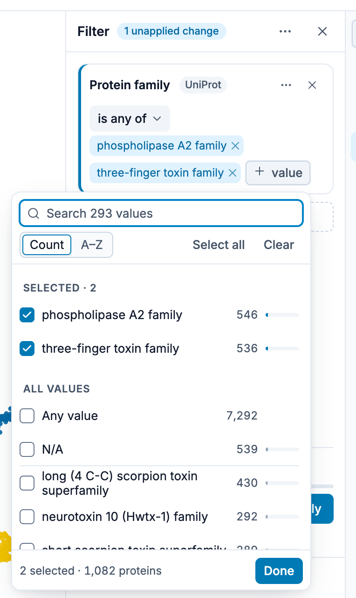
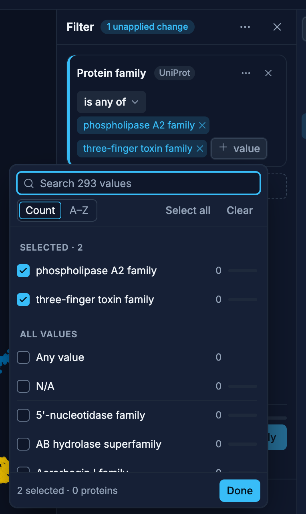
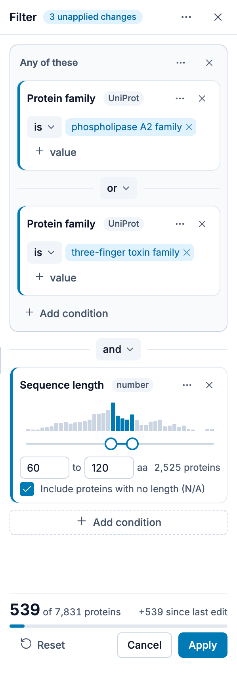

# Filtering

The Filter panel shows only the proteins whose annotations match a query you build. On a desktop,
open it with **Filter** in the sidebar's rail. On a tablet it is **Filter** in the
[view bar](/explore/controls#filter) (inside **More** when the window is narrow), and on a phone it
is a tab of the panel under the plot. It takes the legend's place in the sidebar, and its **✕**
returns to the legend.

While a filter is applied, the rail's Filter icon carries a dot and the plot's status corner shows
a **Filtered · N conditions** chip.

{.light-only}
{.dark-only}

## Building a filter

Each condition is a card:

1. Click **Choose annotation** and pick an annotation. The list is grouped by source and has a
   search box, as in [Color by](/explore/controls#color-by).
2. For a category annotation, click **+ value** and tick the values to keep. For a numeric one, set
   the range (see [Numeric conditions](#numeric-conditions)).
3. Click **+ Add condition** for another card.
4. Click **Apply** to filter the plot. The panel stays open.

The card's **✕** removes it. Its **⋯** menu has **Change annotation**, **Clear values** and
**Duplicate**. A card you changed since the last Apply has a blue edge on its left side.

The **⋯** in the panel's header has **Add group** and **Clear all**. **Clear all** leaves one empty
card.

### Operators

A category card reads as a sentence, such as "Protein family **is any of** …". Click the operator
to change it:

| Operator          | Keeps the proteins that                                   |
| ----------------- | --------------------------------------------------------- |
| **is any of**     | have one of the chosen values (**is** when you chose one) |
| **is none of**    | have a value, but none of the chosen ones                 |
| **has any value** | have some value for the annotation                        |
| **has no value**  | have no value for the annotation (N/A)                    |

**is none of** leaves out proteins with no value. "Protein family is none of A" means "belongs to
some other family", not "or has no family". To keep the proteins with no family too, add a card
for **N/A** joined with **or**.

### Choosing values

{.light-only}
{.dark-only}

**+ value** opens the annotation's values as a list of checkboxes:

- Type in the search box to find a value.
- Sort the list by **Count** or **A–Z**.
- **Select all** ticks every value the list shows; **Clear** unticks them all.
- The values you ticked are listed first, under **Selected**.
- Each value shows how many proteins have it, and a bar for their share of the proteins.
- **Any value** and **N/A** sit at the top, above a line. Ticking **Any value** clears the other
  values, since "any value or X" is just "any value".

The counts take the other cards into account. In a card joined with **and**, a value's count is
how many of the proteins the other cards keep have that value. The footer says how many values you
ticked and how many proteins they hold. **Done** closes the list.

### And, or and groups

Between two cards, a pill says how they join: **and** (both must match) or **or** (either may
match). Click it to switch.

Joiners are read from top to bottom, so mixing **and** and **or** in one list can be hard to read.
When a switch would mix them, the panel asks **Group these?**:

- **Group these** puts the cards that the new joiner links in a group.
- **Use "or" for all** (or "and") uses the same joiner for the whole list.
- **Cancel** keeps the joiner as it was.

A group is a card of its own, named **Any of these** (joined by or) or **All of these** (joined by
and). **+ Add condition** inside it adds a card to the group. Its **⋯** menu has **Ungroup**, and
its **✕** removes the group with its cards. **Add group** in the panel's **⋯** menu starts an
empty group.

## Numeric conditions

Some annotations hold numbers rather than categories, for example `length`. A numeric card has no
operator. It is a range:

- A histogram shows how the values spread. The bars inside the range are blue, the rest grey.
- Drag the slider's two handles, or type the ends in the two boxes. The empty boxes show the data's
  smallest and largest value.
- Both ends are included: 60 to 120 keeps 60, 120 and everything between.
- An empty box sets no limit on that side.
- **Include proteins with no length (N/A)** keeps the proteins with no value. It is ticked on a new
  card.
- The card shows how many proteins it keeps.

A new numeric card keeps every protein, so it is not a change until you set a range or untick
**N/A**.

The range uses the raw values, not the legend's bins, so the bin settings in the
[legend](/explore/legend) do not change which proteins match.

On a phone the numeric card is smaller: it has no histogram, and the slider sits between the two
boxes.

## Draft, Apply and Cancel

What you change in the panel is a draft. The plot keeps the filter last applied until you click
**Apply**. **Cancel** puts the cards back to that filter.

The header says how many changes are not applied yet, such as **2 unapplied changes**, or
**Applied** when the plot shows the draft. An empty card is not a change.

The footer shows how many proteins the draft keeps, with a bar for their share. After an edit it
also says how the count moved, such as **+539 since last edit**.

Apply is enabled only when applying would change something. While it is disabled, the line under
the buttons says why:

| Reason                                       | What to do                                   |
| -------------------------------------------- | -------------------------------------------- |
| **Choose an annotation to filter by**        | No card has an annotation yet                |
| **Choose an annotation for condition N**     | Card N has no annotation yet                 |
| **Choose a value for condition N**           | Card N has no value yet                      |
| **No proteins match**                        | Loosen the query: an empty plot is not shown |
| **Every protein matches; nothing to filter** | Tighten the query                            |
| **No changes to apply**                      | The draft equals the filter already applied  |

Applying a filter is a step you can undo with **⌘ Z** (Mac) / **Ctrl + Z**, and redo with
**⇧ ⌘ Z** / **Shift + Ctrl + Z**.

## Removing a filter

**Reset** in the panel clears the query and shows every protein again; the panel stays open. The
✕ on the plot's **Filtered** chip (**Remove filter**) does the same from the plot. Either way a
**Filter removed** notification offers **Undo**, which brings the filter back.

## On a phone

The menus and the value list open as sheets from the bottom of the screen, and **Group these?** is
a sheet too. Every button is at least 40 px.

## Reliability and the filter

For a dataset with transferred annotations, the reliability range in the [EAT panel](/explore/eat)
writes one condition into this filter while it hides the predictions outside the range (**Hide**).
The condition shows here as a locked row, such as `Toxin class — reliability ≥ 50 %`:

You cannot edit it here. **Edit in EAT ›** opens the EAT panel, and the ✕ puts the range back to
0–100 %. **Fade** writes no condition. See
[The Filter Panel's Locked Row](/explore/eat#the-filter-panel-s-locked-row).

## Filter or Show only

Both narrow the plot, in different ways:

- **Filter** keeps the proteins whose annotations match a query ("every reviewed protein in these
  two families").
- **Show only these**, in the [selection bar](/explore/controls#selection-bar), keeps the proteins
  you selected by hand, with a click, a box, a lasso or a pasted list.

They can be on at the same time. Each has its own chip in the plot's status corner, and each chip's
✕ removes only that one.
