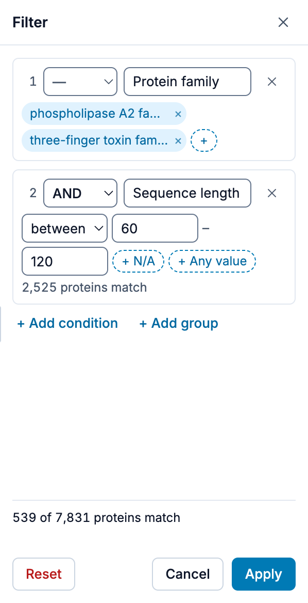
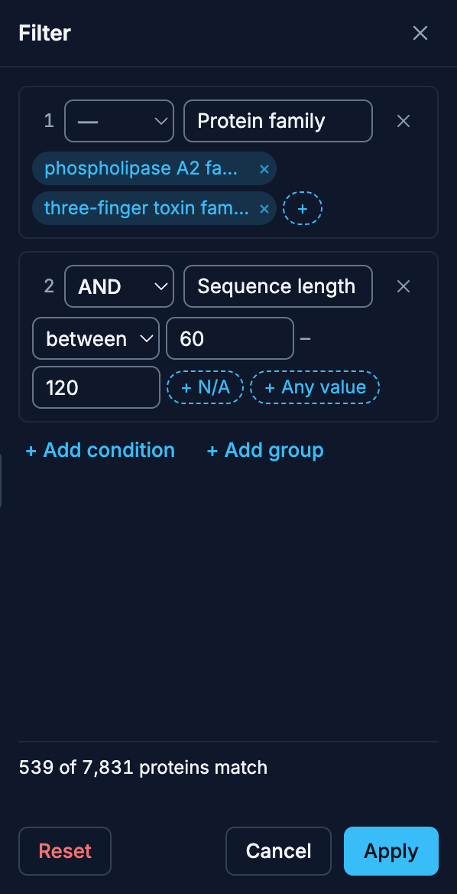

# Filtering

The Filter panel shows only the proteins whose annotations match a query you build. Open it with
**Filter** in the [view bar](/explore/controls#filter) (inside **More** on a narrow window, and a tab
of the folding panel on a phone). It takes the legend's place in the sidebar, and its **✕** returns
to the legend. While a filter is applied, the Filter button shows how many conditions it has, the
sidebar rail's Filter icon carries a dot, and the plot's status corner shows a
**Filtered · N conditions** chip.

{.light-only}
{.dark-only}

## Building a filter

1. Each row is a condition: choose an annotation, then click **+** to pick values
2. Click **+ Add condition** for another row, and combine rows with **AND**, **OR**, or **NOT**
3. Click **+ Add group** for nested logic (a parenthesised group of conditions)
4. The live count shows how many proteins match the query
5. Click **Apply** to filter the plot; the panel stays open

::: tip Logical Operators

- **AND**: Protein must match both conditions
- **OR**: Protein must match either condition
- **NOT**: Protein must have a value for the annotation **and** not match the condition

The first condition can optionally be set to **NOT** for immediate negation.

**NOT** deliberately excludes proteins with no value (N/A) for the annotation
being negated. Negating one protein family, for example, means "belongs to some
other family", not "belongs to some other family, or has no family assigned at
all". To include unannotated proteins as well, add an explicit **N/A** condition
with **OR**.
:::

::: tip Missing values

Annotations offer presence entries alongside their real values:

- **N/A**: proteins with no value for this annotation — listed whenever the
  annotation actually has missing values
- **Any value**: proteins that have some value — any value at all; always offered

**Any value** is exclusive: selecting it clears the other values, since "Any
value or X" is just "Any value".

Numeric annotations offer the same two entries next to their comparison, so
`≥ 0.7` plus **N/A** reads "at least 0.7, or no score at all". A presence entry
on its own is a complete condition — no bounds needed.
:::

## Numeric range conditions

Some annotations hold numbers rather than categories (for example `length`). When you pick a
numeric annotation, the row **switches to numeric mode automatically**: the **+** value picker is
replaced by a range input. There is no query text to type; you choose an operator and fill in the
bound(s):

| Operator  | Fields shown | Matches                              |
| --------- | ------------ | ------------------------------------ |
| `>`       | min          | value **strictly** greater than min  |
| `≥`       | min          | value greater than or equal to min   |
| `<`       | max          | value **strictly** less than max     |
| `≤`       | max          | value less than or equal to max      |
| `between` | min and max  | min ≤ value ≤ max (**both ends** in) |

`>` is the default operator on a new numeric condition. Switching operators clears any bound the
new operator does not use, so a hidden value cannot silently re-constrain the filter.

For example, `length` `between` `100` and `300` matches proteins with 100 ≤ length ≤ 300 (both ends
included), while `length` `>` `500` excludes a protein of exactly length 500.

Comparisons use the **raw numeric value**, not the legend's bin labels, so the bin settings in the
[legend](/explore/legend) do not affect which proteins a numeric condition matches.

A condition with a missing bound matches nothing, and the live count only appears once the
condition is complete.

::: warning Missing values
A protein with no value for the annotation never matches a comparison. Wrapping the condition in
**NOT** re-includes those proteins, because NOT is the complement of the matched set. To include
them directly, add the **N/A** entry next to the comparison.
:::

## Draft, Apply and Cancel

What you change in the panel is a draft: the plot keeps the filter last applied until you click
**Apply**. **Cancel** returns the conditions to that filter.

Apply is enabled only when applying would change something. While it is disabled, the line under
the count says why:

| Reason                                       | What to do                                   |
| -------------------------------------------- | -------------------------------------------- |
| **Add a condition**                          | The query is empty                           |
| **Choose an annotation for condition N**     | Condition N has no annotation yet            |
| **Choose a value for condition N**           | Condition N has no value yet                 |
| **Enter a number for condition N**           | Condition N's comparison lacks a bound       |
| **No proteins match**                        | Loosen the query: an empty plot is not shown |
| **Every protein matches; nothing to filter** | Tighten the query                            |
| **No changes to apply**                      | The draft equals the filter already applied  |

Applying a filter is a step you can undo with **⌘ Z** (Mac) / **Ctrl + Z**, and redo with
**⇧ ⌘ Z** / **Shift + Ctrl + Z**.

## Removing a filter

**Reset** in the panel clears the query and shows every protein again; the panel stays open. The
✕ on the plot's **Filtered** chip (**Remove filter**) does the same from the plot. Either way a
**Filter removed** notification offers **Undo**, which brings the filter back.

## Reliability and the filter

For a dataset with transferred annotations, the reliability control in the legend's
**Predicted (transferred)** section is a front end for this filter: moving it writes one condition
on the annotation's EAT confidence, which you can see and edit here, and editing that condition
moves the control. See [Filtering By Reliability](/explore/eat#filtering-by-reliability).

## Filter or Show only

Both narrow the plot, in different ways:

- **Filter** keeps the proteins whose annotations match a query ("every reviewed protein in these
  two families").
- **Show only these**, in the [selection bar](/explore/controls#selection-bar), keeps the proteins
  you selected by hand, with a click, a box, a lasso or a pasted list.

They can be on at the same time. Each has its own chip in the plot's status corner, and each chip's
✕ removes only that one.
