# Interface Overview

The Explore page is a workbench for protein embeddings: a map of your proteins in the middle, two bars above it, and a sidebar beside it.

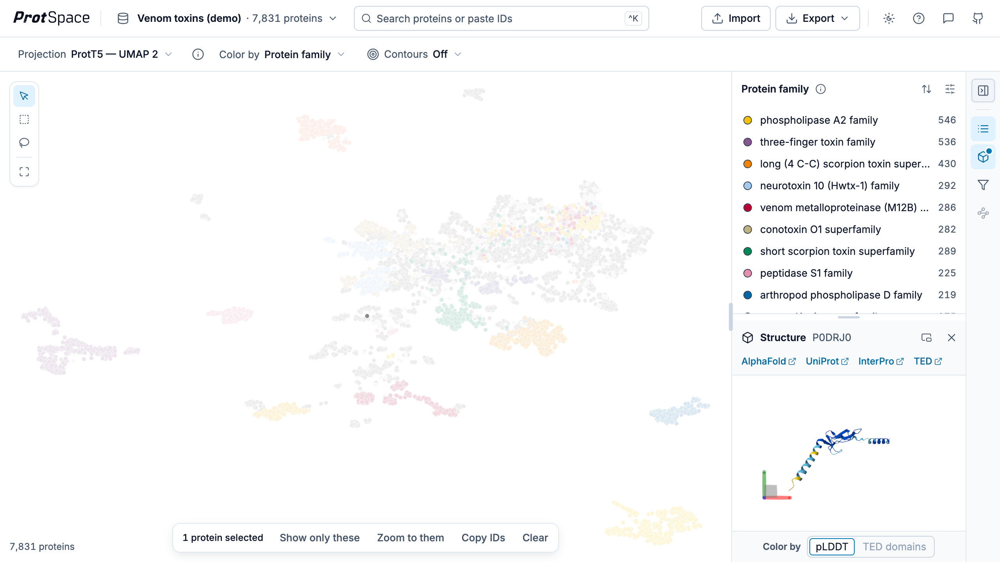
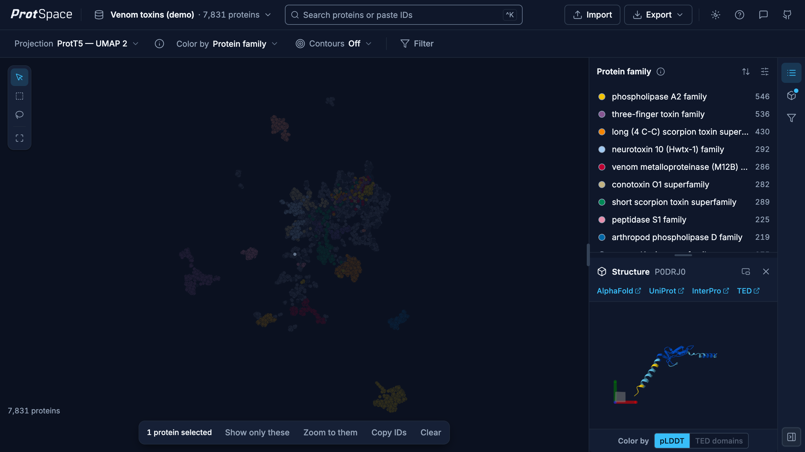

## Page layout

| Area         | Where             | What it holds                                                      |
| ------------ | ----------------- | ------------------------------------------------------------------ |
| **App bar**  | Top               | The dataset name, search, Import, Export, the theme and Help       |
| **View bar** | Below the app bar | Projection, Color by, Contours and Filter                          |
| **Plot**     | Centre            | The scatterplot, its tools, the selection bar and the status chips |
| **Sidebar**  | Right             | The Legend, Structure and Filter panels, switched from the rail    |

## App bar

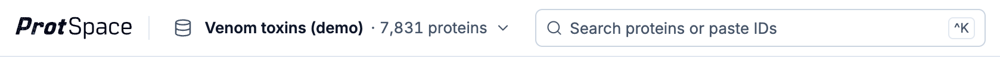{.light-only}
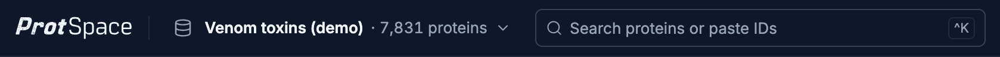{.dark-only}

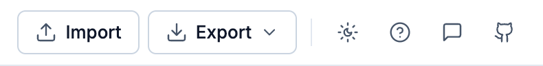{.light-only}
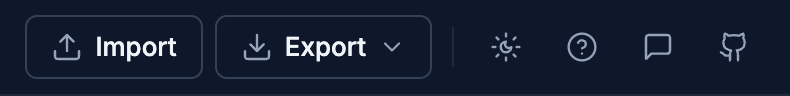{.dark-only}

- **Dataset name** shows what is loaded and how many proteins it holds. Click it for the [dataset menu](/explore/controls#dataset-menu): the example datasets, your last file and **Open a file…**.
- **Search** finds proteins by ID; paste a list of IDs to select them all at once. See [Search](/explore/controls#search).
- **Import** and **Export** load data and save images, figures and data. See [Importing Data](/explore/importing-data) and [Exporting Results](/explore/exporting).
- **Theme** switches between System, Light and Dark; see [Light and dark](#light-and-dark).
- **Help** has the documentation, the keyboard shortcuts and the tour; see [Help, shortcuts and the tour](#help-shortcuts-and-the-tour).
- **Feedback** starts an email to the ProtSpace team, and **GitHub** opens the project's repository.

## View bar

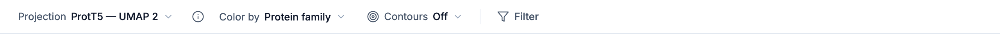{.light-only}
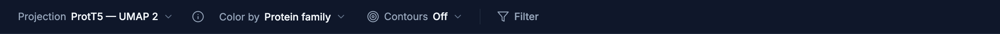{.dark-only}

- **Projection** picks the 2D map: PCA, UMAP, t-SNE, PaCMAP, MDS or LocalMAP. The button beside it opens the [projection details](/explore/scatterplot#projection-metadata), with the projection's quality scores and settings.
- **Color by** picks the annotation that colours the points.
- **Contours** draws density rings for each legend colour: Off, Auto or Always.
- **Filter** opens the [Filter panel](/explore/filter) in the sidebar.

The bar never wraps. In a narrow window the labels shorten first, then Contours and Filter move into **More**. Each control is described on [Bars and Tools](/explore/controls#view-bar).

## Plot

The plot shows your proteins as points in 2D. Points close together have similar embeddings. Both axes share one scale, so a distance reads the same in every direction.

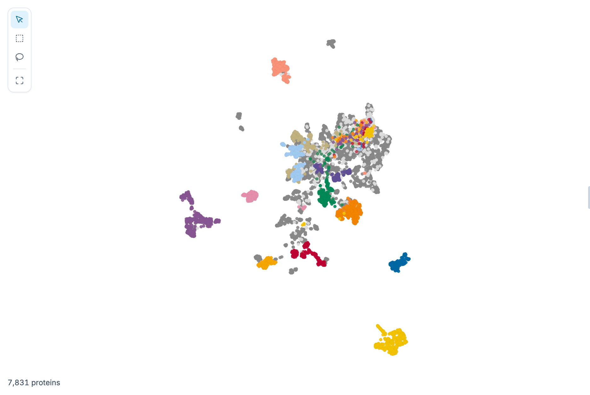

- **Scroll** to zoom and **drag** to pan; **double-click** the background to reset the zoom.
- **Click** a point to select it and see its structure; **⌘/Ctrl + click** adds a point to the selection or takes it out.
- The [tool strip](/explore/controls#selection-tools) in the top-left corner switches between Move and zoom, Box select and Lasso select, and fits every point back in view.
- With a selection, the [selection bar](/explore/controls#selection-bar) at the bottom offers Show only these, Zoom to them, Copy IDs and Clear.
- [Status chips](/explore/controls#status-chips) in the bottom-left corner, beside the protein count, say what is hidden; their ✕ shows it again, and [Undo](/explore/controls#undo-and-redo) takes back the last step.

[Navigating the Scatterplot](/explore/scatterplot) has the details.

## Sidebar

The rail on the sidebar's right edge switches between its three panels and folds the sidebar away:

- **Legend** shows the categories of the current colouring.
- **Structure** shows the selected protein in 3D; a dot on its rail button means a protein is loaded.
- **Filter** builds a [filter](/explore/filter) from annotation values.

**Collapse sidebar**, the rail's last button, folds the sidebar to the rail and gives the plot the whole width; **Expand sidebar** brings it back. Drag the sidebar's left edge to make it wider or narrower.

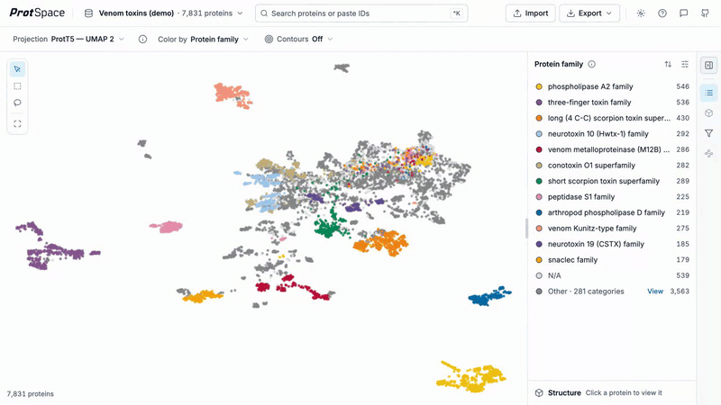

### Legend

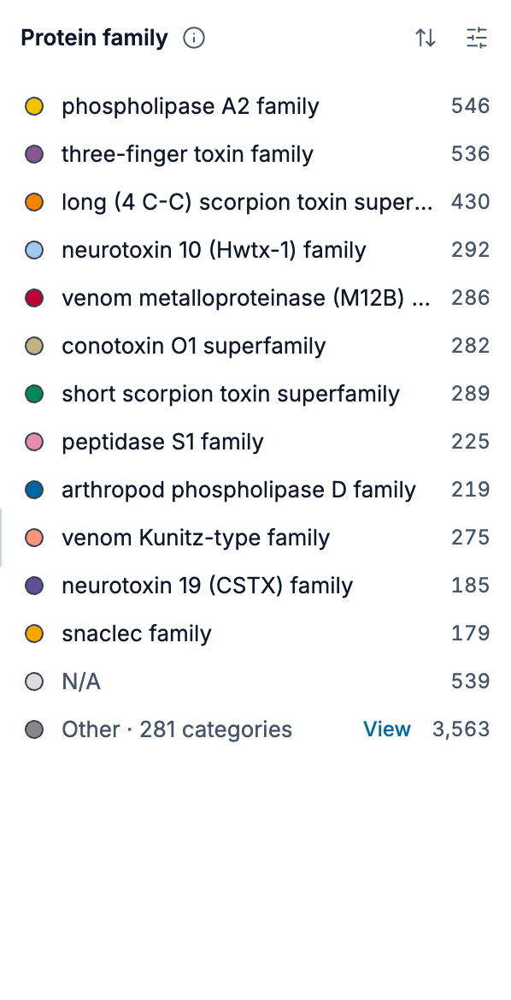
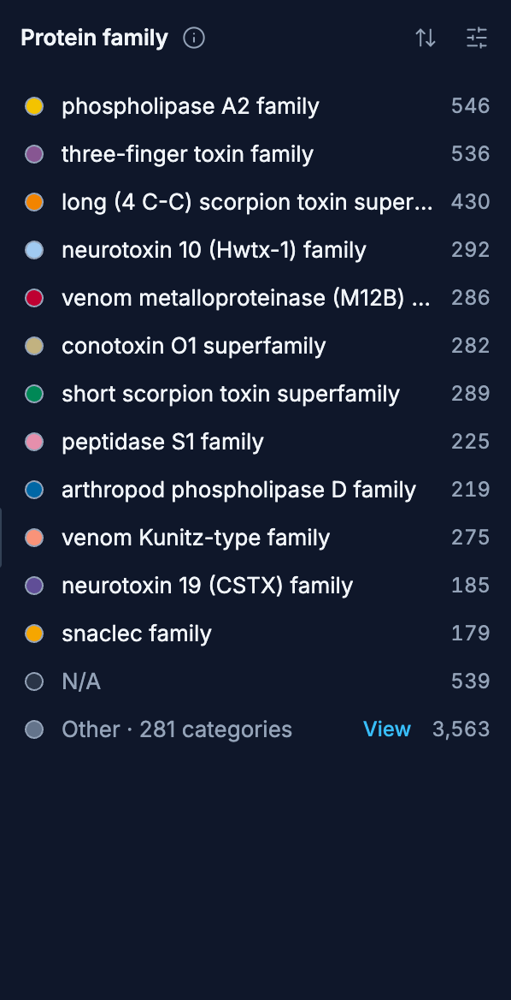

- Click a row to hide or show its category; double-click it to show only that one.
- Drag a row by its handle to reorder; higher rows are drawn on top in the plot.
- The sliders button in the header opens **Legend settings**; the sort button orders the rows.
- Scored datasets add [separation score strips](/explore/separation-scores) above the rows.
- Annotations with [transferred values](/explore/eat) add a `Predicted (transferred)` section.

[Using the Legend](/explore/legend) has the details.

### Structure

Selecting a protein loads its AlphaFold structure under the legend. A row of links under its title opens the protein's [AlphaFold Database](https://alphafold.ebi.ac.uk/), [UniProt](https://www.uniprot.org/), [InterPro](https://www.interpro.org/) and [TED](https://ted.cathdb.info/) entries in new tabs. Drag the divider above it to share the height with the legend, or pop the structure out to float over the plot.

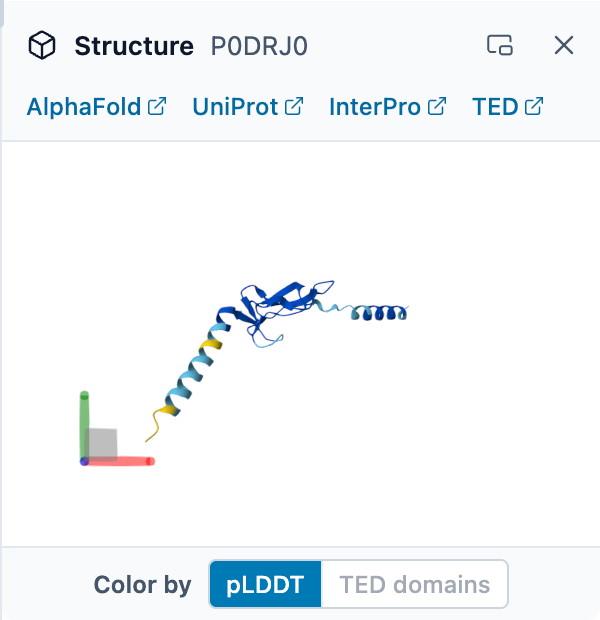
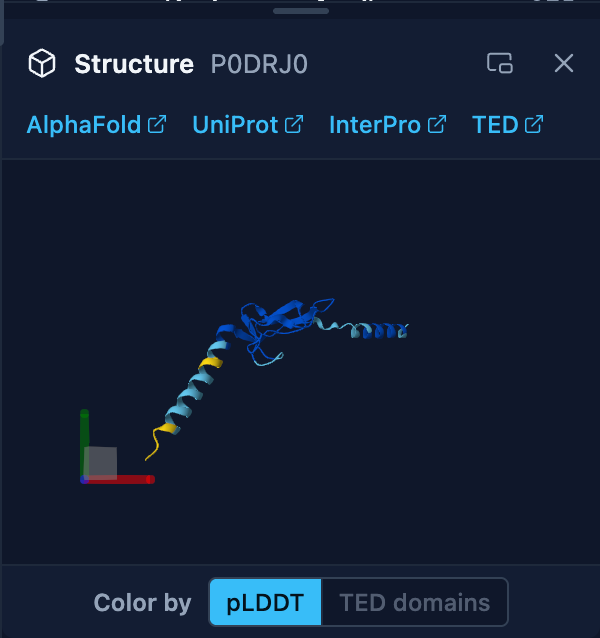

[Viewing 3D Structures](/explore/structures) has the details.

## Light and dark

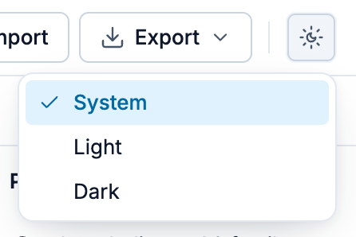{.light-only}
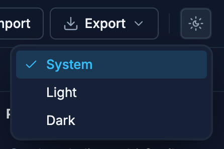{.dark-only}

The Theme button in the app bar offers three choices:

- **System** follows your operating system's light or dark setting, and changes when it does.
- **Light** and **Dark** stay as you set them.

Your choice is remembered in this browser. The plot, the legend and the 3D structure follow the theme. Exports and figures are always light, so a figure looks the same whichever theme you made it in. On a phone the Theme choice is in **More**.

## Help, shortcuts and the tour

**Help** at the right end of the app bar has three items:

- **Documentation** opens these pages in a new tab.
- **Keyboard shortcuts** lists every shortcut, grouped by where it works.
- **Take the tour** plays the product tour from its first step.

The tour runs once by itself, the first time you open Explore. It points at each part of the workbench in turn; **Skip**, the ✕ or <kbd>Esc</kbd> ends it at any step. If you used ProtSpace before this layout, you see a short **What's new** tour once instead, which shows what moved; its **Full tour** button switches to the whole tour. On a phone, Help is in **More** → **Help & shortcuts**, and the tour uses touch gestures.

## Keyboard shortcuts

**Help** → **Keyboard shortcuts** lists them all. The ones you will use most:

| Keys                              | What they do                                                                               |
| --------------------------------- | ------------------------------------------------------------------------------------------ |
| <kbd>⌘K</kbd> / <kbd>Ctrl+K</kbd> | Focus the search box                                                                       |
| <kbd>⌘Z</kbd> / <kbd>Ctrl+Z</kbd> | Undo the last selection, show-only or filter step; add <kbd>⇧</kbd> to redo                |
| <kbd>Esc</kbd>                    | Close the open menu or dialog; otherwise clear the selection, then return to Move and zoom |
| <kbd>Shift</kbd> + hover          | Focus the category of the point under the pointer                                          |
| <kbd>i</kbd>                      | In the legend, show only the focused category                                              |

## Phones and tablets

ProtSpace picks a layout from the window's size, and the same page works with touch:

| Window                                                       | Layout                                                                                          |
| ------------------------------------------------------------ | ----------------------------------------------------------------------------------------------- |
| 951 px wide and more                                         | The desktop workbench described above                                                           |
| 641 to 950 px wide (tablets)                                 | The plot on top; the legend and the structure side by side below it                             |
| 640 px wide or less (phones)                                 | One fixed screen: the bars, the plot, and a panel under it                                      |
| A phone on its side (500 px tall or less, under 951 px wide) | The page scrolls once past the bars to a plot-and-legend view; the structure opens on the right |

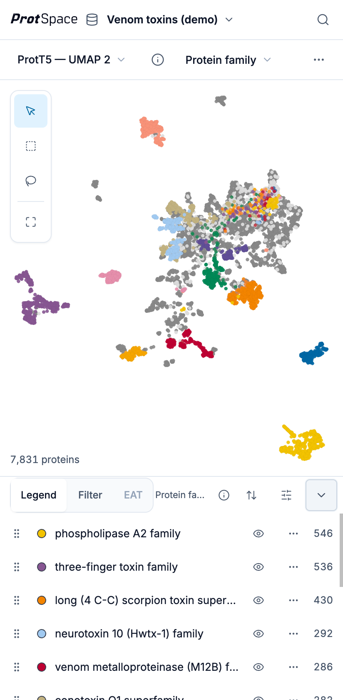
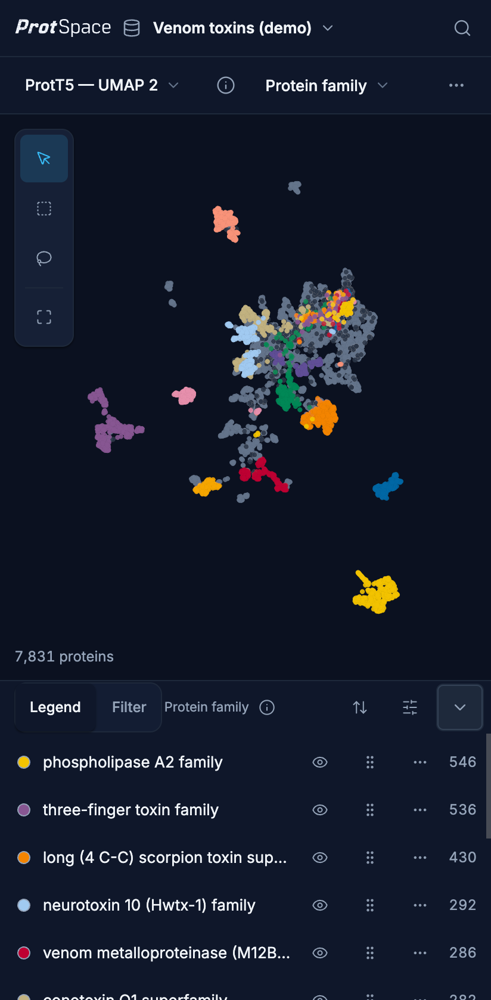
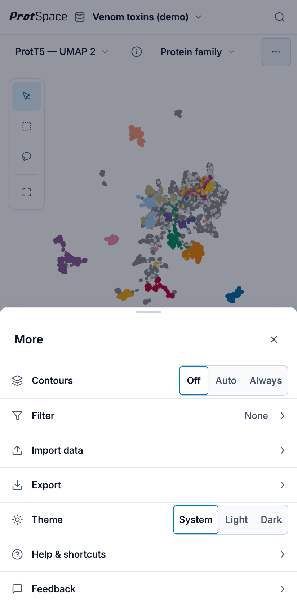
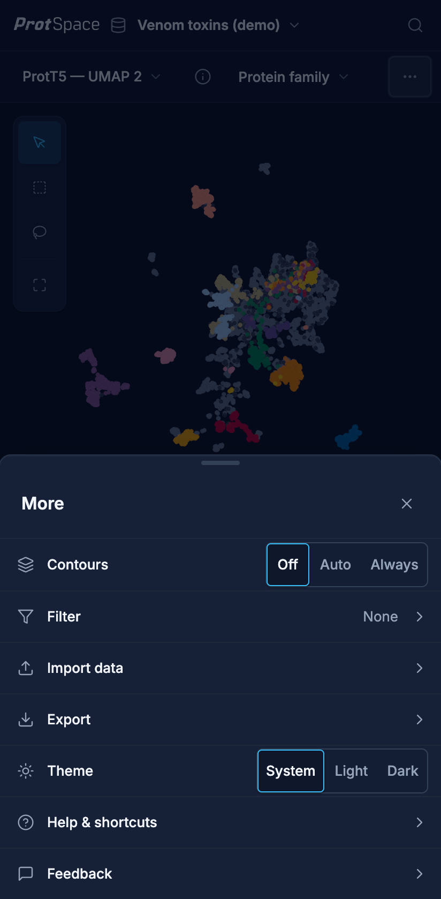
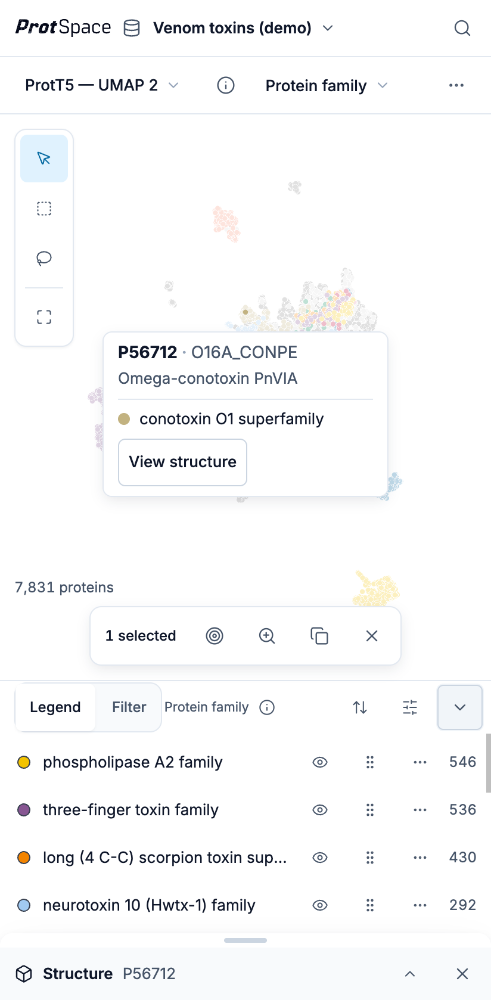
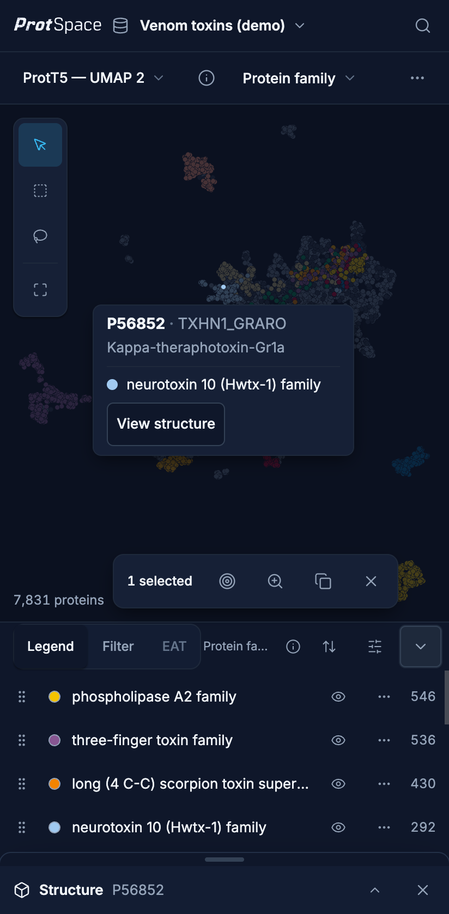

On a phone:

- The app bar keeps the wordmark, the dataset's name and a search button, which opens search over
  the bar. The view bar keeps **Projection**, **Color by** and **More**.
- **More** opens a sheet with everything else: **Contours**, **Filter**, **Import data**,
  **Export**, **Theme** (System, Light, Dark), **Help & shortcuts** (Documentation, Keyboard
  shortcuts, Take the tour) and **Feedback**. A dot on **More** says something in it is active,
  such as contours or a filter.
- The panel under the plot holds the legend and the Filter panel, switched by the **Legend** and
  **Filter** tabs. Its chevron folds it to its header to give the plot the room.
- Tapping a protein selects it and pins its tooltip. Its structure opens in a sheet at the bottom,
  folded to its header so the plot and the tooltip stay in view; the header's chevron, or **View
  structure** in the tooltip, expands it. While it is expanded, a tap on the plot opens no tooltip.

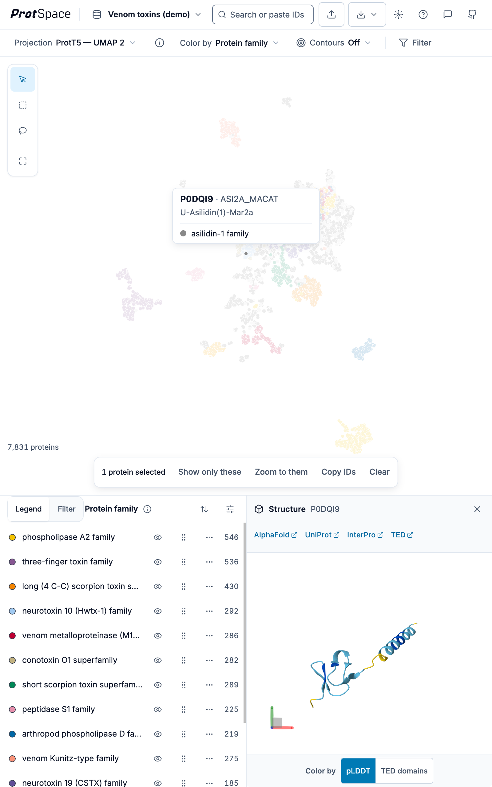

On every touch screen:

- Drag to pan, pinch to zoom; a tap on empty space or a pan closes a pinned tooltip.
- Tap a legend row to hide or show it, and double-tap it to show only that category. The row's
  eye, handle and ⋯ menu are always shown, and every control is at least 40 px.
- To reorder the legend, hold a row's handle for a moment, then drag it.

## Next steps

- [Importing Data](/explore/importing-data): load your protein data
- [Bars and Tools](/explore/controls): every control in the bars and on the plot
- [Navigating the Scatterplot](/explore/scatterplot): move around and select proteins
- [Using the Legend](/explore/legend): hide, reorder and style categories
- [Filtering](/explore/filter): narrow the plot to the proteins you need
- [Viewing 3D Structures](/explore/structures): the AlphaFold viewer
