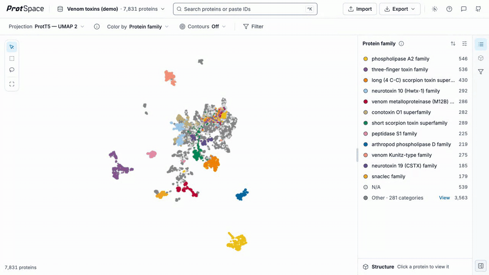
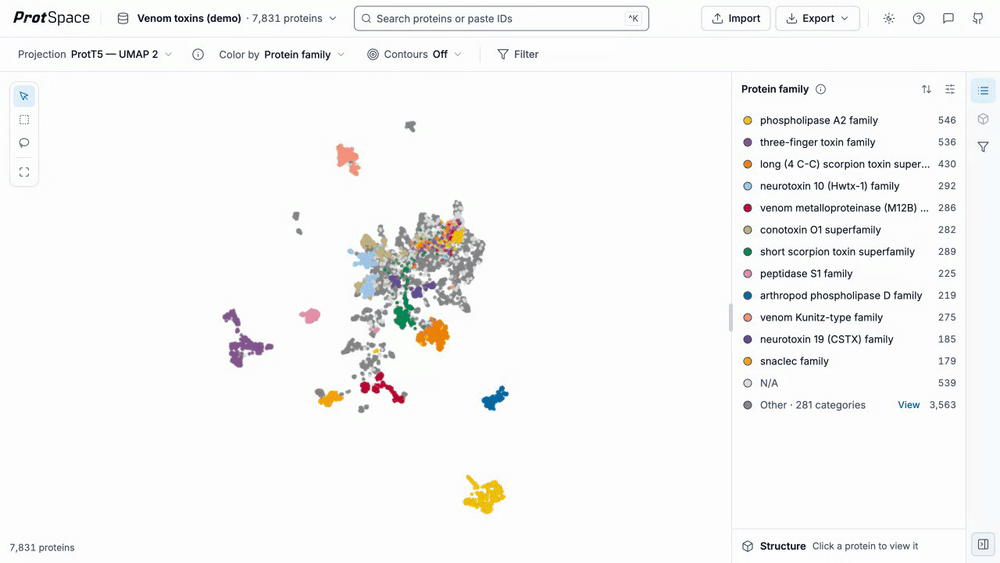
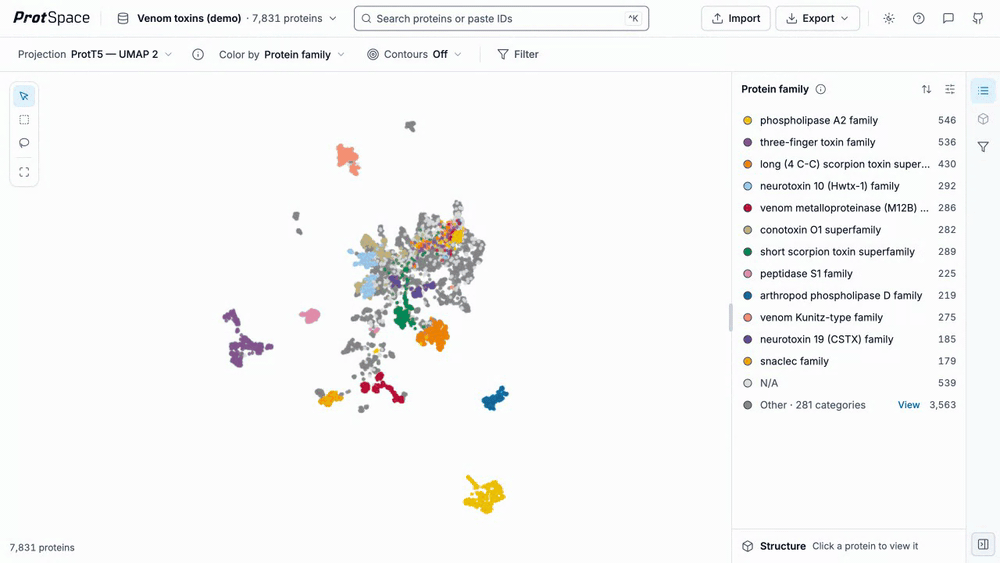
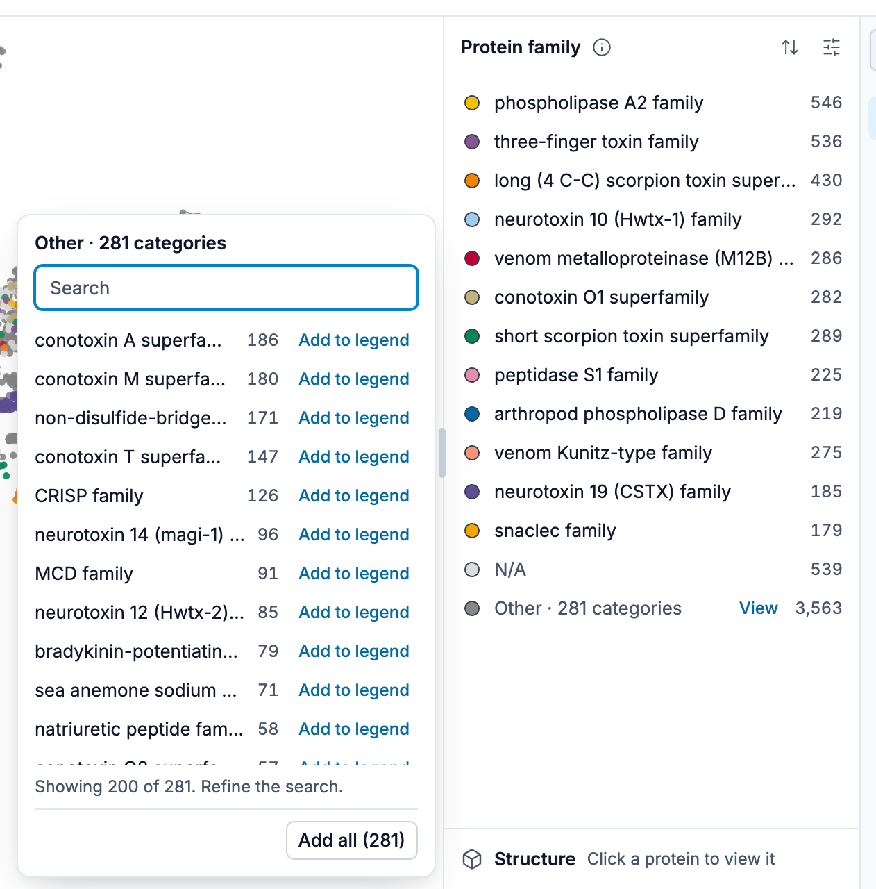
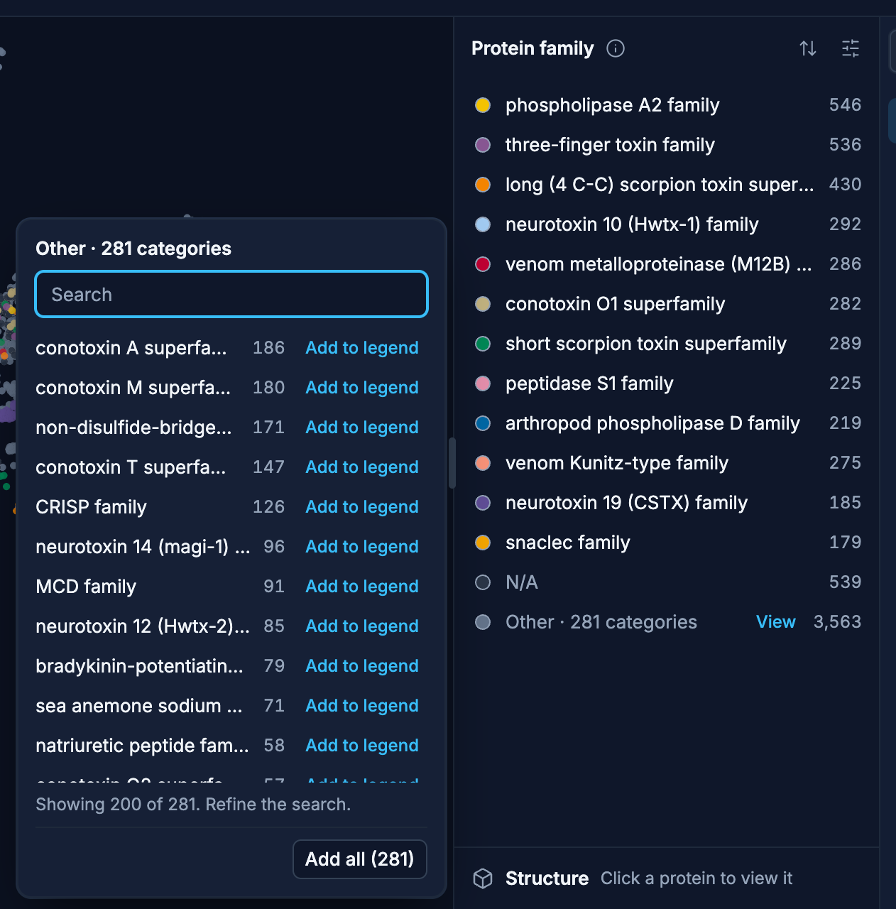
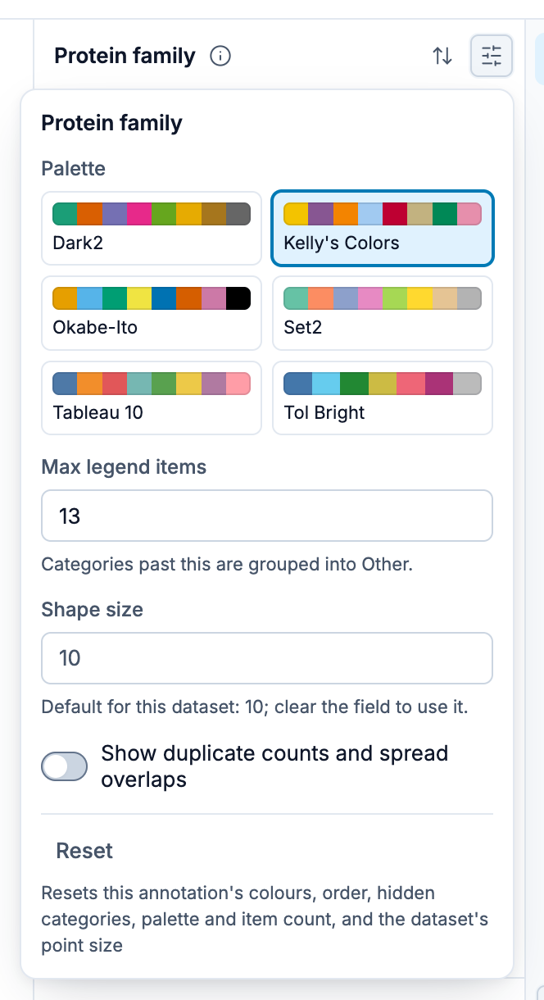
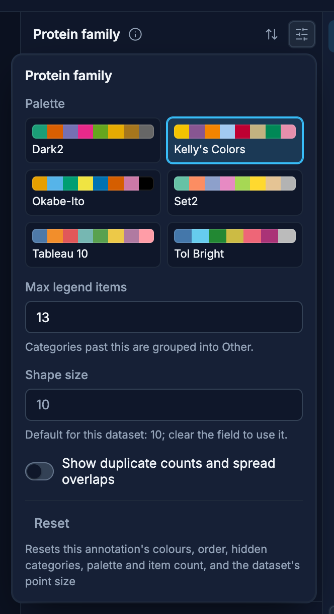

# Using the Legend

The legend panel lets you filter, customize, and explore protein annotations. Most annotations are categorical, but scalar numeric annotations such as `length` are handled a little differently.

## Rows

Each category is one row: its colour, its name and its protein count. A long name ends in an
ellipsis and shows in full on hover. Hovering a row shows three controls at its right:

- an **eye**, which hides or shows the category,
- a **drag handle**, which moves the row (see [Reordering](#reordering-and-draw-order)),
- a **⋯** menu with **Show only this** and **Colour and shape**.

On a touch screen the controls are always shown and every row is a 40 px target.

## Show And Hide Values

Click any legend row to toggle its visibility:

- Click once, or press its eye, to hide that value. A hidden row stays in the list, dimmed, with a
  crossed-out eye.
- Click again, or press the eye again, to show it.
- Double-click a row, or choose **Show only this** from its ⋯ menu, to show that value and hide the
  rest.
- Double-click the only shown value again (its ⋯ menu then reads **Show all**) to show all values.
- If only one value remains visible, clicking it restores the full set.

While categories are hidden, the plot's status corner shows `N categories hidden`; its ✕ shows them
all again. On a touch screen, tap a row to hide or show it and double-tap it to show only that value.

From the keyboard: the arrow keys, **Home** and **End** move between rows, **Enter** hides or shows
the focused row, and **i** shows only it.

## Reordering And Draw Order

Drag a row by its handle up or down to change the draw order in the scatterplot. Items near the top
are drawn on top of items below them.

Dragging switches the annotation's order to **Your order**. On a touch screen, hold the handle for a
moment, then drag. From the keyboard, focus a row's handle, press **Space** to pick the row up, move
it with the arrow keys and press **Space** again to drop it (**Escape** cancels).

## The "Other" Group

Categorical annotations group less frequent values into `Other` once the visible list exceeds the
current legend cap (**Max legend items** in the [settings](#settings)). The row reads
`Other · N categories`.

- Press **View** on the `Other` row to open a popover listing the grouped values, largest first,
  each with its count.
- Type in its search box to find one, then press **Add to legend** to give it its own row (the
  legend cap rises by one). **Add all** moves every value out of `Other`.
- Drag a row onto `Other` to group it there again.

{.light-only}
{.dark-only}

Numeric annotations do **not** use `Other`. They are binned directly from the raw numeric values.

## Transferred Annotations (EAT)

When the selected annotation carries values borrowed from nearby annotated proteins, one line under the legend's title says so, such as `Includes 659 predicted`, with an **EAT ›** link. Once you narrow the reliability range it adds what happens to the predictions outside it, `· outside 50–100 % hidden` (or `faded`), and with predictions off it reads `659 predictions off, shown as N/A`. The line holds no controls: **EAT ›** opens the EAT panel, which has them all. Borrowed values join their label's row and count while predictions are shown.

See [Transferred Annotations (EAT)](/explore/eat) for the EAT panel, where the borrowed values come from and how to read them in the plot.

## Separation Score Strips

When the dataset was prepared with statistics and the selected annotation was scored in the current projection, two strips appear near the top of the legend panel, above the category list: one for `Silhouette`, one for `Davies–Bouldin`. Each plots one dot per category, in that category's legend color, so you can see which values sit apart from the rest and which overlap.

- Hovering a dot highlights the matching legend row, and hovering a row highlights its dot.
- Clicking a dot toggles that category, exactly like clicking its legend row.
- While a filter or isolation narrows the view, the strips are replaced by the note `Separation scores are hidden while the view is filtered.`

See [Separation Scores](/explore/separation-scores) for what the numbers mean and how they are computed.

## Sorting

The sort button in the legend's header shows the active order in its tooltip, such as
`Sort: By count, largest first`. Press it to open
the **Sort legend** menu:

- **By count**, largest first (categorical annotations)
- **By name** (categorical) or **By value** (numeric)
- **By separation**, only when the selected annotation carries per-category
  [separation scores](/explore/separation-scores) for the current projection: categories ordered by
  how cleanly each one separates. It is display-only: it reorders the list without changing which
  categories fall into `Other`, and it keeps working while the view is filtered.
- **Your order**, the order you dragged the rows into
- **Reverse order**, a checkbox that flips the active order:
  - Numeric `By value`: low-to-high vs high-to-low
  - `Your order`: reverses your order
  - `By separation`: best-separating first vs worst-separating first
  - `By count` and `By name`: the reverse of each

## Settings

The sliders button in the legend's header opens **Legend settings** for the selected annotation. Changes apply
as you make them: there is no Save button. A number applies a moment after you stop typing, or at
once on **Enter** or when you leave the field.

{.light-only}
{.dark-only}

**Reset**, at the bottom, restores the defaults for the selected annotation: its colours, order,
hidden categories, palette and item count, and the dataset's point size. It is unavailable while
nothing is changed.

### Shared Settings

| Setting                                       | What it does                                                                                                                                                                                                                                                                                                                                                                      |
| --------------------------------------------- | --------------------------------------------------------------------------------------------------------------------------------------------------------------------------------------------------------------------------------------------------------------------------------------------------------------------------------------------------------------------------------- |
| **Palette**                                   | Picks the active palette for the selected annotation from its swatches.                                                                                                                                                                                                                                                                                                           |
| **Max legend items**                          | Categorical annotations: maximum number of visible values before grouping into `Other`. Numeric annotations (labelled `Bins`): target maximum number of bins.                                                                                                                                                                                                                     |
| **Shape size / Point size**                   | Adjusts marker size in the scatterplot (range 1 to 64; a larger size from a bundle or an earlier session is capped at 64). The default follows the dataset's protein count, see [Default dot size](#default-dot-size). The size you pick holds for every annotation of the dataset. Numeric annotations use the label `Point size` because numeric legends always render circles. |
| **Show duplicate counts and spread overlaps** | Shows duplicate count badges and spreads overlapping points when you expand them.                                                                                                                                                                                                                                                                                                 |

### Default dot size

Until you pick a size, the dot size follows how many proteins the dataset has, so a large dataset
opens with dots small enough that one category does not cover the others:

| Proteins in the dataset | Up to 10,000 | 20,000 | 40,000 | 100,000 | 570,000 |
| ----------------------- | ------------ | ------ | ------ | ------- | ------- |
| Default shape size      | 10           | 6      | 4      | 2       | 1       |

The count is the whole dataset, so hiding categories, filtering or isolating does not change it.
Legend settings show the dataset's default under the size field. A size you type is stored for the
dataset and exported with **Include legend settings**. A size a bundle sets for an annotation, other
than 10 or 30, also overrides the default. To return to the default, clear the size field. This
drops the size you picked and every size a bundle set per annotation, but keeps the annotation's
other settings. `Reset` does the same for the size, and also resets the selected annotation's
colours, order and hidden values.

### Numeric Bin Distribution

When the selected annotation is numeric and a numeric gradient palette is active, an extra `Bin distribution` control appears:

- `Linear`
- `Quantile`
- `Logarithmic`

`Quantile` is the default distribution, automatically falling back to `Linear` when the number of distinct values is small enough that quantile edges would collapse. `Logarithmic` is only available when all non-null values are strictly positive; otherwise ProtSpace falls back to `Quantile` (and from there to `Linear`, as above).

### Reverse Gradient Direction

Numeric annotations also have a `Reverse gradient` switch in Legend settings.

- Off: lower numeric values use the low end of the selected gradient and higher values use the high end.
- On: the gradient is flipped so higher numeric values receive the colors that would normally be used for lower values, and vice versa.

This setting is saved with the rest of the numeric legend settings and is restored on reload or bundle import.

## Numeric Annotations

Scalar numeric annotations are stored as raw numbers and binned in the browser from the current numeric settings.

### Numeric Labels

Numeric legend labels are display summaries for humans:

- They use `min - max` formatting instead of comparison syntax like `<`.
- Integer-only data stays integer-only in the legend.
- Decimal labels only appear when the source data actually needs decimal precision.
- Single-value bins are shown as a single number.

The exact runtime bin edges are still used for membership. The displayed label is a summary of the values observed in that bin.

### Why Fewer Bins Can Appear Than The Max

For numeric annotations, `Max legend items` (`Bins`) is a target cap, not a hard guarantee. You can request `10` bins and still see fewer when the data does not support all of them.

Common reasons:

- A linear or logarithmic interval ends up empty, so it is dropped from the realized legend.
- Quantile cut points collapse because many proteins share the same value.
- A constant numeric column produces exactly one bin.
- An all-null numeric column produces zero bins.
- Very narrow ranges can collapse after precision/topology normalization.

This is why you might see `10` requested bins become `9`, and `9` become `8`, without anything being wrong.

## Predicted Annotations

Some annotations are computational predictions rather than experimentally curated records. When one
is selected, the legend header shows a ⚡ **Predicted** badge next to the annotation title, followed
by the note `Computationally predicted, not experimentally curated.` The same ⚡ marker appears next
to the annotation in the view bar's **Color by** menu.

The badge marks columns produced by a machine-learning model, a de-novo sequence-topology
predictor, or predicted 3D structure. Reference signature matches such as Pfam, CATH-Gene3D and
SUPERFAMILY, and curated or factual UniProt and Taxonomy fields, are not badged. Any unknown column
whose name starts with `predicted_` is treated as a prediction.

Which built-in columns carry the badge is listed per annotation in the
[Annotations reference](/guide/annotations), which is generated from the same table the app reads.

The ⚡ badge is a property of the whole column and is decided from the annotation's name, not from
its values, so it is not the same thing as the `EAT` badge, which marks an otherwise curated column
in which some individual proteins carry a transferred value.

## Colors, Gradients, And Shapes

### Categorical Palettes

Categorical annotations use discrete palettes. ProtSpace keeps the established categorical options for contrast and colorblind safety:

- Kelly's Colors
- Okabe-Ito
- Tol Bright
- Set2
- Dark2
- Tableau 10

Colors stay attached to categories when you reorder them.

### Numeric Gradients

Gradients are only shown for numeric annotations. ProtSpace currently ships five curated sequential gradients:

- `Batlow`: scientific-publication oriented sequential ramp from Fabio Crameri's Scientific Colour Maps (default)
- `Cividis`: colorblind-friendly sequential gradient
- `Viridis`: balanced perceptually uniform sequential gradient
- `Inferno`: high-contrast dark-to-bright ramp
- `Plasma`: vivid exploratory sequential ramp

These were chosen because they are either perceptually uniform, publication-friendly, accessibility-aware, or visually distinctive for ordered data. Rainbow-style maps are intentionally excluded because they are a poor default for numeric interpretation.

Numeric bin colors are derived from the gradient and the selected distribution. They are not manually edited per bin.

If an imported bundle or saved browser state references an unsupported numeric gradient ID, ProtSpace falls back to `batlow`.

### Special Categories

| Category  | Color     | Shape  |
| --------- | --------- | ------ |
| **Other** | `#888888` | Circle |
| **N/A**   | `#DDDDDD` | Circle |

### Shapes

Every category renders as a circle by default. To give a category another colour or shape (square, diamond, plus, triangle-up, triangle-down), choose **Colour and shape** from its row's ⋯ menu: the popover has a Shape section underneath the colour picker.

Numeric and multi-label annotations always render as circles; per-category shape assignment is not available for those.

## Saved Settings

Legend settings are saved per dataset and per annotation in the browser.

- Saved examples: visibility, palette, ordering, numeric binning settings, and duplicate-count preferences
- Numeric binning settings such as palette, gradient direction, strategy, and target bin count are restored on reload/import
- Numeric hidden values and your order are only restored when the current numeric topology still matches the saved one
- The shape size is the exception: it is saved once per dataset, applies to every annotation, and
  travels in exported bundles with **Include legend settings**
- Use `Reset` in Legend settings to clear saved preferences for the selected annotation; it also
  clears the dataset's shape size and every annotation's own size, including sizes a bundle set
  per annotation, so the [default](#default-dot-size) applies to every annotation again

## Styling From The Python CLI

`protspace style` can pre-set legend styling inside a bundle, but its keys are categorical only. For
a numeric annotation the web app reinterprets or ignores most of them, because numeric legend
entries are bin IDs such as `num:quantile:150:200` rather than per-value keys.

`Bin distribution` and `Reverse gradient` are UI-only settings and cannot be authored from
the CLI.

See [How CLI keys are reinterpreted for numeric columns](/guide/styling#how-cli-keys-are-reinterpreted-for-numeric-columns)
for the per-key reference.

## Multi-Label Annotations

When proteins have multiple values, such as multiple EC numbers:

- Points display as pie charts
- Each slice represents one value
- All unique values appear in the legend

## Next Steps

- [Separation Scores](/explore/separation-scores) - the strips at the top of the legend panel, and how well each category separates
- [Bars and Tools](/explore/controls) - projections, colour, contours, search, import and export
- [Filtering](/explore/filter) - narrow the plot to proteins that match conditions
- [Viewing 3D Structures](/explore/structures) - AlphaFold integration
