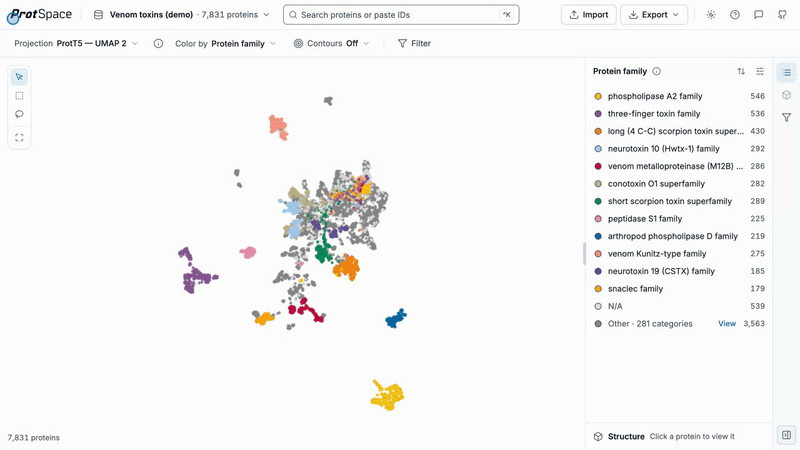
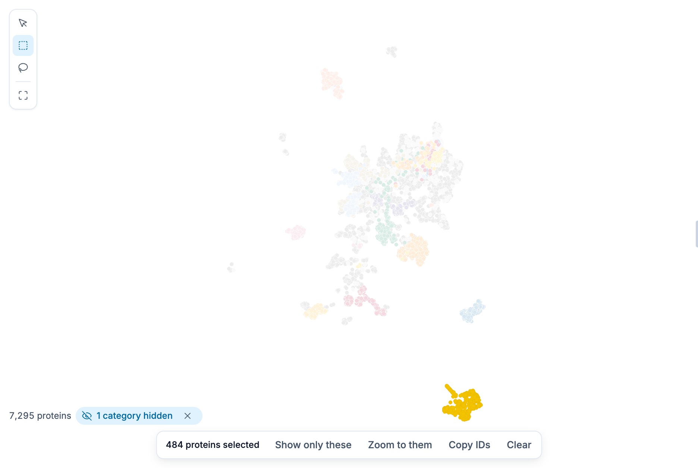
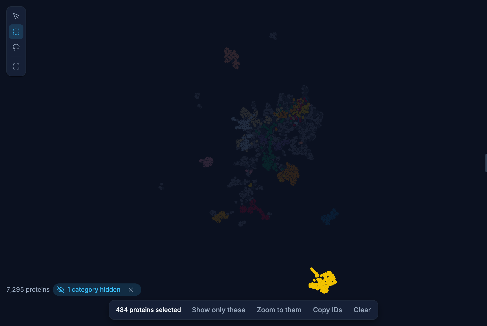
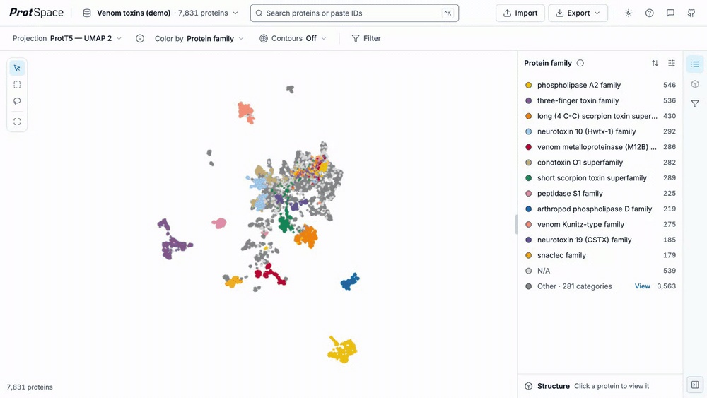
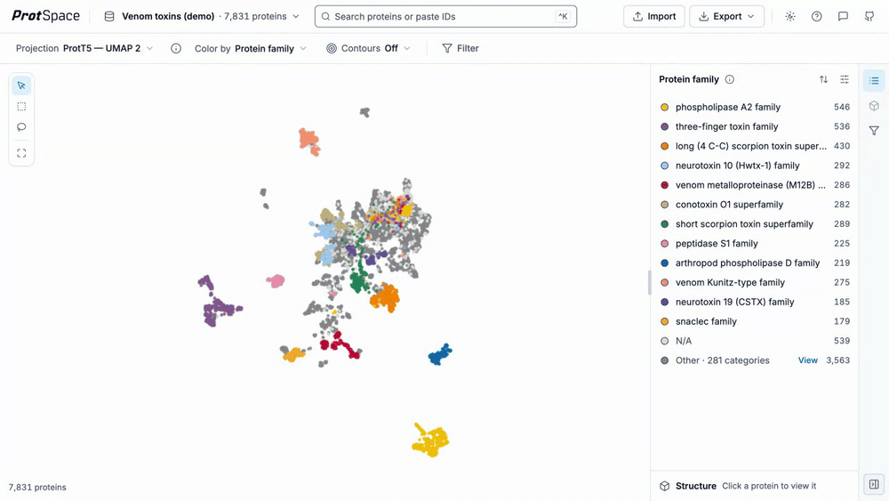
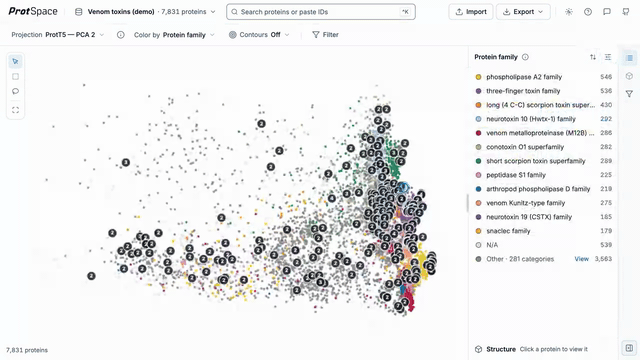
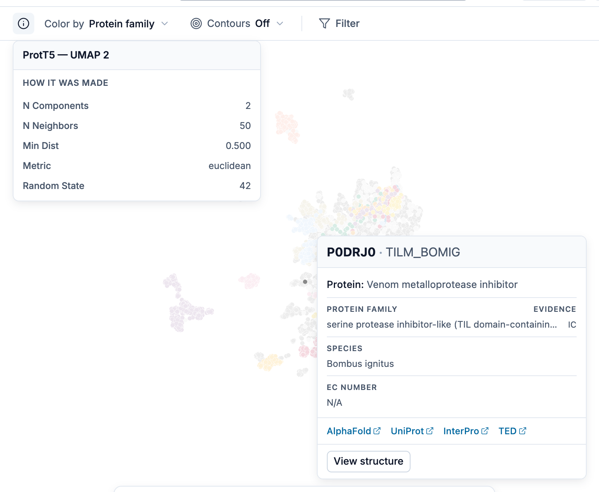
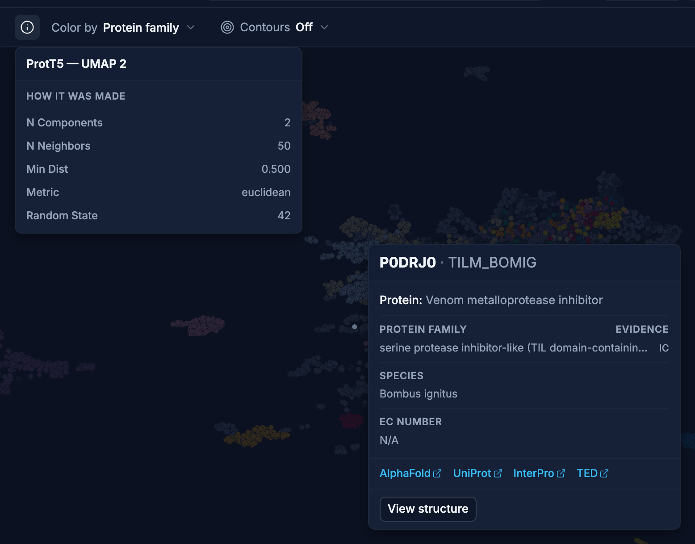

# Navigating the Scatterplot

The scatterplot is the main visualization area where proteins appear as points. Learn how to navigate, select, and explore your data.

## Quick Reference

| Action                    | How                                                                  |
| ------------------------- | -------------------------------------------------------------------- |
| Zoom in/out               | Mouse wheel, or pinch on a touch screen                              |
| Pan                       | Drag the background with **Move and zoom** on                        |
| Fit every protein         | Double-click the background, or **Fit to view** in the tool strip    |
| Focus a category          | Hold **Shift** and hover a point                                     |
| Select one                | Click a point                                                        |
| Add or remove one         | **⌘/Ctrl** + click a point                                           |
| Box or lasso select       | Pick **Box select** or **Lasso select** in the tool strip, then drag |
| Clear the selection       | Press **Escape**, or **Clear** in the selection bar                  |
| Back to **Move and zoom** | Press **Escape** again                                               |
| Undo / redo               | **⌘/Ctrl + Z** / **⇧ + ⌘/Ctrl + Z**                                  |
| Focus search              | **⌘/Ctrl + K**                                                       |

## Navigation

- **Zoom**: Scroll wheel or pinch gesture
- **Pan**: Drag the background while **Move and zoom** is the active tool
- **Reset**: Double-click the background, or press **Fit to view** at the bottom of the tool strip,
  to fit all proteins

Dots grow as you zoom in, so single proteins stay easy to see and to hover: a dot's radius is ×1.4
at 4× zoom, ×2 at 16×, and never more than ×4. Zooming out never shrinks them below their unzoomed
size, which you set with the shape size in the [legend](/explore/legend#shared-settings). Until you
pick one, it [follows the dataset's protein count](/explore/legend#default-dot-size): 10 up to
10,000 proteins, smaller for larger datasets. Dots are
also a little larger on a big plot and a little smaller on a small one (×0.8 to ×1.5 against a
1000 × 700 px plot), and the same size on every pixel density. Hovering picks a dot anywhere within
its drawn radius, or within 4 px of its centre when it is smaller than that.

To see where categories concentrate when their points overlap, turn on
[Contours](/explore/controls#contours).

## Status corner

The bottom-left corner of the plot shows how many proteins you can see, as `N proteins`, followed by
`· Zoomed in` while you are zoomed in. Proteins of hidden legend values are not counted, and in a
narrowed view only the proteins in that view count. Each protein id counts once, so a protein that
appears on more than one point is not counted twice.

Beside the count, a chip says each way the view is narrowed:

| Chip                                | Press the text to     | Its ✕                      |
| ----------------------------------- | --------------------- | -------------------------- |
| `Filtered · N conditions`           | open the Filter panel | **Remove filter**          |
| `Showing only N proteins · K steps` | (nothing to open)     | **Show all proteins**      |
| `N categories hidden`               | open the legend       | **Show hidden categories** |

See [Filtering](/explore/filter) for the filter and [Show And Hide Values](/explore/legend#show-and-hide-values)
for hidden categories.

## Selection

{.light-only}
{.dark-only}

The tool strip in the plot's top-left corner picks what a drag on the plot does: **Move and zoom**
(the default), **Box select** or **Lasso select**. **Fit to view** sits below them. Box and lasso
are unavailable while the view holds fewer than two points.

### Single & Multi-Select

- **Click** a point to select it, and show its structure
- **⌘ + click** (Mac) or **Ctrl + click** (Windows, Linux) to add a point to the selection, or
  remove it
- Click the only selected point again to deselect it
- Choose an already selected (marked) suggestion in the [search box](/explore/controls#search) to
  deselect it

### Box Selection

1. Pick **Box select** in the tool strip
2. Drag to draw a rectangle
3. All proteins inside are added to the selection

### Lasso Selection

1. Pick **Lasso select** in the tool strip
2. Drag to draw a freeform outline around proteins
3. Release to add all enclosed proteins to the selection

The lasso needs at least 3 points to form a valid area.

::: tip Adding to a selection
While **Box select** or **Lasso select** is on, every click, box and lasso adds to the selection,
and a click on a selected protein removes it. With **Move and zoom**, a click selects just that
protein.
:::

### The selection bar

While proteins are selected, a bar at the bottom of the plot shows how many and what you can do
with them:

- **Show only these** narrows the plot to the selection. Each time you do it is one step of the
  `Showing only … · K steps` chip; its ✕ (**Show all proteins**) brings every protein back.
- **Zoom to them** fits the view to the selected proteins.
- **Copy IDs** copies their identifiers, one per line.
- **Clear** empties the selection.

### Clearing

- Press **Escape** to clear the selection (first press), then to go back to **Move and zoom**
  (second press). Escape closes an open menu, popover or pinned tooltip first.
- Press **Clear** in the selection bar

### Undo and redo

**⌘Z** (Mac) or **Ctrl+Z** undoes the last selection change, **Show only these** step, or filter
Apply or Reset; **⇧⌘Z** or **Ctrl+Shift+Z** redoes it. Undo does nothing while the cursor is in a
text field, where these keys edit the text.

## Understanding the Display

### Point Position

Points close together have similar embeddings - often indicating similar structure, function, or evolutionary history.

Both axes share one scale, so a cluster keeps its shape whatever the size of the window: the plot
fits the data's extent inside the plot area and centres it, and a window wider than the data shows
margin at the sides (a taller one, above and below). Opening or closing the sidebar changes how
much room the plot has, never the clusters' proportions. Exported images use the same rule, so a
figure has the shape you see on screen. A projection whose first axis spans much more than its
second, as PCA often does, shows as a band rather than filling the plot.

### Point Colors

- **Categorical** (reviewed, protein family, species): Unique color per category
- **Multi-label** (EC numbers, domains): Pie charts showing multiple values

### Protein Tooltip

Hover over a point to see a tooltip with details about that protein:

- **Protein ID** and **UniProtKB ID** (if available)
- **Protein name** and **Gene name** (if available)
- **Annotation values** for the currently selected annotation
- **Scores** (for InterPro domain annotations, e.g., E-values) or **evidence codes** (for GO terms, subcellular location, etc., e.g., EXP, IDA)

Protein name, gene name, and UniProtKB ID are tooltip-only and don't appear in the
[Color by menu](/explore/controls#color-by).

When the structure cannot be seen (on a desktop, while the sidebar is collapsed with the structure
docked in it), a click on a point pins its tooltip with a **View structure** button, which opens
the sidebar and shows that protein's structure. On a phone, a tap pins the tooltip and **View
structure** expands the structure sheet. A pinned tooltip closes on **Escape**, a press outside
the plot, the next click, or a pan or zoom.

### Focusing a Category

Hold **Shift** while hovering a point to see where its category sits: every protein sharing one of its values in the current annotation stays bright, everything else fades. Move to another point to switch category; release **Shift** or move off the point to go back.

- Hovering a point in the legend's **Other** group focuses the whole group
- Hidden legend values stay hidden, and the tooltip is hidden while focusing
- Focus is only a preview: it does not change the selection, and it is off while proteins are selected

### Duplicate Points

When multiple proteins share the exact same coordinates, a **count badge** appears on the point
once **Show duplicate counts and spread overlaps** is on in the [legend settings](/explore/legend#settings).
Click a stacked point to spread it into a spider layout showing each protein; click a protein in
the spider to select it, and click the badge or press **Escape** to fold it again.

### Projection Metadata

{.light-only}
{.dark-only}

A small ⓘ button sits beside **Projection** in the view bar. Hover it (or focus it with the
keyboard) to open a **Projection Metadata** card describing the current projection. Click the
button to pin the card open, so you can scroll it and read the ⓘ popovers inside without keeping
the pointer on the card. **Escape** or a click outside closes it; switching projections updates it.

::: tip
The button only appears when the loaded bundle has something to show: reduction parameters,
faithfulness metrics, or statistics for the annotation you are colouring by, either its separation
in this projection or, for a clustering, its Recovers table. Any one is enough, so a bundle prepared
with `--stats` but no projection metadata still gets a card, and a clustering found in another
projection gets one on Recovers alone. A bundle carrying none of them shows no button at all.
:::

The card's header is the projection's own name. Below it, in order:

- **Separation, scored on `<annotation>`**, how cleanly the current annotation's categories separate
  in this projection, with the source embedding's own scores beside them as a reference. Documented on
  [Separation Scores](/explore/separation-scores).
- **Recovers**, only when the current annotation is a `cluster_elbow_*` / `cluster_silhouette_*`
  clustering: how closely that clustering reproduces each real annotation. Documented under
  [Cluster Annotations](/explore/separation-scores#cluster-annotations).
- **Faithfulness to the embedding**, described below.
- **How it was made**, described below.

#### Faithfulness to the embedding

How well the 2D or 3D layout preserves the structure of the original high-dimensional embedding, as
one labelled row per metric under two group headings. Every row carries its value and its own ⓘ
popover.

**Local — are the same proteins still neighbours?**

- **kNN Overlap**, fraction of each point's k nearest neighbors preserved in the projection
- **Trustworthiness**, penalizes points pulled together in the projection that were far apart
- **Continuity**, penalizes points pushed apart in the projection that were close together

**Global — is the overall layout preserved?**

- **Random Triplet**, fraction of random point triplets whose relative ordering survives
- **Spearman Distance**, rank correlation between high-dimensional and projected pairwise distances

The neighborhood size `k`, the high-dimensional distance metric, and the source embedding are the
same for every metric, so no row repeats them: one scope line covers all of them, such as
`811 proteins compared`, gaining `· subsampled` when the comparison ran on a subsample. These
metrics travel in the projection metadata (`info_json.quality`), not in the statistics part, so they
appear whether or not the bundle was built with `--stats`.

#### How it was made

The parameters the dimensionality-reduction method was run with, read from the bundle's projection
metadata table. **Source** names the embedding the projection was computed from, which is useful
when a bundle contains projections from several embeddings. The rest depend on the method:

- **PCA**, `N Components`, plus `Explained Variance Ratio` (one value per component)
- **UMAP**, `N Neighbors`, `Min Dist`, `Metric`, `Random State`, and the rest of the UMAP
  parameter set

Two things are deliberately absent from the list: the dimension count, which you already pick in the
[Projection menu](/explore/controls#projection), and the projection's name, which is the card header
rather than a row.

#### Across the whole card

Values anywhere on the card are formatted for readability: whole numbers print as-is, other numbers
are rounded to three decimals (two for explained-variance values), booleans show as **Yes**/**No**,
lists are comma-separated, and a value that is missing or could not be computed shows as `N/A`.

Whenever the card carries any scores at all, separation or faithfulness, it ends with a footer
reading `All scores are for the full dataset.`, becoming
`All scores are for the full dataset, not this view.` while a filter or isolation narrows the plot,
for the reason on [Separation Scores](/explore/separation-scores#scores-cover-the-whole-dataset).
