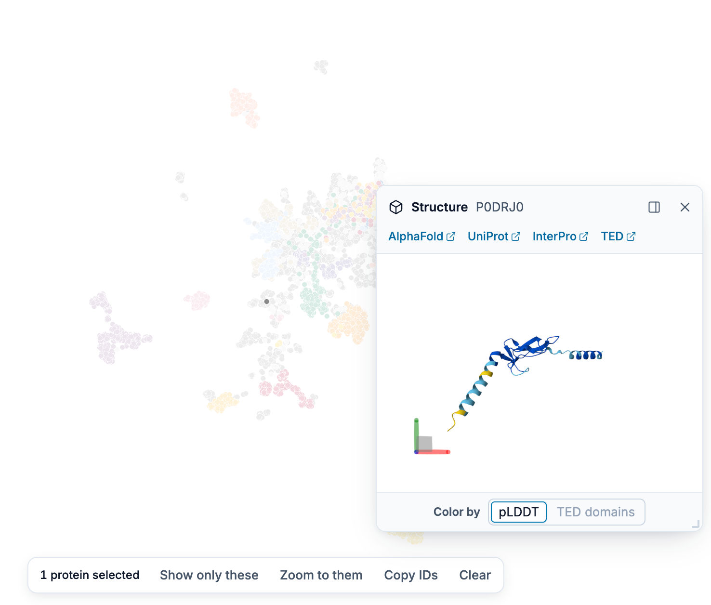
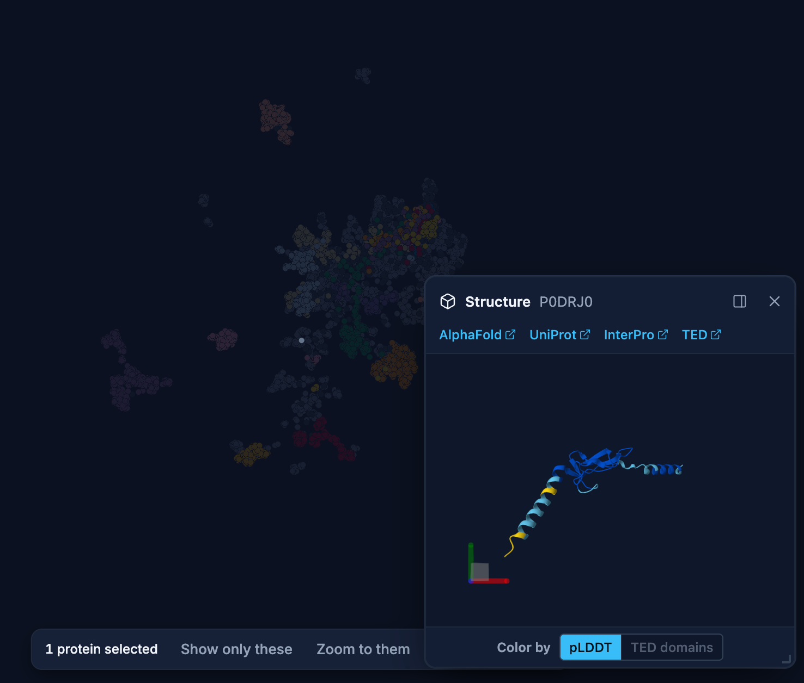

# Viewing 3D Structures

ProtSpace shows the predicted 3D structure of the protein you click, from the
[AlphaFold Database](https://alphafold.ebi.ac.uk/), next to the plot.

## How It Works

When you click a protein with a UniProt accession:

1. Its structure opens in the structure viewer, under the legend in the sidebar
2. A row of links to [AlphaFold Database](https://alphafold.ebi.ac.uk/),
   [UniProt](https://www.uniprot.org/), [InterPro](https://www.interpro.org/), and
   [TED](https://ted.cathdb.info/) appears under the title; each opens in a new tab
3. The AlphaFold structure file is fetched directly from the
   [AlphaFold Database API](https://alphafold.ebi.ac.uk/api-docs); the
   [3D-Beacons API](https://www.ebi.ac.uk/pdbe/pdbe-kb/3dbeacons/) is used only to look up the model
   page link
4. Optional TED domain annotations are requested from
   `https://alphafold.ebi.ac.uk/api/domains/{accession}`; the structure still loads if annotations
   are unavailable

::: tip Supported Structures
Currently, ProtSpace supports **AlphaFold structures** only. PDB experimental structures are not yet
integrated.
:::

## Where the Structure Shows

### Docked in the sidebar

On a desktop window the viewer sits under the legend. Drag the divider between them to give either
more room; with the divider focused, the arrow keys move it, and **Home** and **End** move it to
either end.

### Floating over the plot

**Pop out structure** in the viewer's header moves it into a card over the plot, at its
bottom-right corner. Drag the card's header to move it and its corner grip to resize it; with the
card focused, the arrow keys move it (with **Shift**, farther), and with the grip focused they resize
it. **Dock structure** puts it back under the legend, opening the sidebar if it was collapsed. The
card keeps its place and size the next time you pop it out. Popping out is offered on desktop
windows only.

{.light-only}
{.dark-only}

### Docked, with the sidebar collapsed

While the structure is docked and the sidebar is collapsed to its rail, a click still chooses the protein, but nothing is
downloaded until the structure is visible. A dot on the rail's **Structure** button marks the chosen
protein, and its tooltip names it; click the button, or **View structure** in the protein's pinned
tooltip, to open the sidebar and load it.

### Hiding the structure

On desktop windows, the rail's **Structure** button hides the structure and shows it again. Hidden,
a docked structure leaves the whole sidebar to the legend or the filter, and a floating card goes
away; the next click brings it back where it was. The structure stays hidden after a reload. A
click on a protein while it is hidden chooses the protein without showing it; **View structure** in
the protein's pinned tooltip shows it.

### On phones

On a phone the structure is a sheet at the bottom of the screen; on a phone on its side it sits
under the legend on the right and expands over the right half of the screen. It opens folded to its
header when you tap a protein; **View structure** in the protein's tooltip, the header or its
chevron (**Show the structure**) unfolds it, and the chevron (**Hide the structure**) folds it
again. While it is unfolded, a tap on the plot does not pin a tooltip under it. On a tablet the structure always has its own place on screen.

## Several Selected Proteins

With more than one protein selected, the protein ID in the viewer's header becomes a menu of the
selected proteins: up to the first 50, with a search field when there are more than 8. Pick one to
show its structure instead.

## Confidence and Domain Coloring

Structures initially use **predicted Local Distance Difference Test (pLDDT)** confidence scores,
the same scheme used on the [AlphaFold Database](https://alphafold.ebi.ac.uk/). Regions in **blue**
are high-confidence, **yellow** moderate, and **red** low-confidence. This helps you quickly spot
which parts of the model are more reliable.

Use the **Color by** control to switch between **pLDDT** and **TED domains** without reloading the
structure. TED mode assigns a consistent categorical color to every segment of a domain and shows
residues without a TED assignment in gray. The TED domains option is disabled when valid
annotations are unavailable for the selected protein.

The viewer's background follows the page's theme; the model's colours do not change with it.

## Viewer Controls

| Action                         | Effect                                    |
| ------------------------------ | ----------------------------------------- |
| **Color by pLDDT/TED domains** | Switch the loaded structure's color theme |
| **Left drag**                  | Rotate the structure                      |
| **Right drag**                 | Pan the view                              |
| **Scroll**                     | Zoom in/out                               |
| **Double-click**               | Reset the view                            |

## When Structures Aren't Available

Not all proteins have AlphaFold structures. When no structure is found, the viewer displays:

> "No 3D structure was found for \<Protein ID\>"

## Next Steps

- [Exporting Results](/explore/exporting) - Save your findings
- [FAQ](/guide/faq) - Common questions
